# ZombieDefend Asset Catalog

> **Generated file — do not edit by hand.** Regenerate with `python3 tools/build-asset-catalog.py` (see [README.md](README.md#how-to-update)).
> Visual catalog: [catalog.html](https://peterlei853.github.io/ZombieDefend/assets/library/catalog.html) · machine index: [asset-index.json](asset-index.json)

| Category | Groups | Assets |
|---|---:|---:|
| [Hero](#hero) | 3 | 86 |
| [Pets](#pets) | 17 | 96 |
| [UI](#ui) | 1 | 41 |
| [Zombies](#zombies) | 12 | 145 |
| [Bosses](#bosses) | 4 | 39 |
| [Shared FX](#fx) | 1 | 1 |
| [Pickups](#pickups) | 1 | 5 |
| [Environment](#environment) | 1 | 2 |
| [Backgrounds](#backgrounds) | 1 | 15 |
| [Concepts](#concepts) | 1 | 21 |
| **Total** | **42** | **451** |

## Hero

### Player Girl (hero) (女主角)

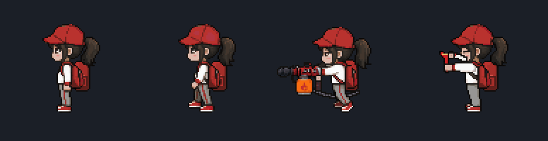

Chibi girl hero with red cap and backpack; base moves plus six weapons (water, bubble, lightning crossbow, frost, flame, sling). Faces WEST unless the key ends in -walk-east/-north/-south.

- group `girl` · 50 assets · frame 92x92 · key prefix `player-girl-` · manifest [characters/hero/girl/manifest.json](characters/hero/girl/manifest.json)
- previews: [all-base-sheet.png](previews/hero/girl/all-base-sheet.png), [weapon-water.gif](previews/hero/girl/weapon-water.gif), [weapon-bubble.gif](previews/hero/girl/weapon-bubble.gif), [weapon-lightning.gif](previews/hero/girl/weapon-lightning.gif), [weapon-frost.gif](previews/hero/girl/weapon-frost.gif), [weapon-flame.gif](previews/hero/girl/weapon-flame.gif), [weapon-sling.gif](previews/hero/girl/weapon-sling.gif)

| Key | Frames | Size | FPS | Playback | Origin | Notes |
|---|---:|---|---:|---|---|---|
| `player-girl-idle` | 8 | 92x92 | 8 | loop | (0.5, 0.8261) |  |
| `player-girl-walk-west` | 6 | 92x92 | 10 | loop | (0.5, 0.8261) | head of frame 0 re-used on frames 3-5 (PixelLab turned the head) |
| `player-girl-walk-east` | 6 | 92x92 | 10 | loop | (0.5, 0.8261) | faces east |
| `player-girl-walk-south` | 6 | 92x92 | 10 | loop | (0.5, 0.8261) | faces south |
| `player-girl-walk-north` | 6 | 92x92 | 10 | loop | (0.5, 0.8261) | faces north |
| `player-girl-hurt` | 4 | 92x92 | 12 | once | (0.5, 0.8261) |  |
| `player-girl-die` | 8 | 92x92 | 10 | once | (0.5, 0.8261) | hit flash 0, recoil 1-2, fall 3-5, lying 6-7 (hold last frame) |
| `player-girl-victory` | 8 | 92x92 | 10 | loop | (0.5, 0.8261) |  |
| `player-girl-water-idle` | 6 | 92x92 | 8 | loop | (0.5, 0.8261) |  |
| `player-girl-water-ready` | 6 | 92x92 | 10 | once | (0.5, 0.8261) | reach back to the backpack 0-2, pull out 3, bring up to aim 4-5 |
| `player-girl-water-walk-south` | 6 | 92x92 | 10 | loop | (0.5, 0.8261) | faces south |
| `player-girl-water-walk-north` | 6 | 92x92 | 10 | loop | (0.5, 0.8261) | faces north |
| `player-girl-bubble-idle` | 6 | 92x92 | 8 | loop | (0.5, 0.8261) |  |
| `player-girl-bubble-ready` | 6 | 92x92 | 10 | once | (0.5, 0.8261) | reach back to the backpack 0-2, pull out 3, bring up to aim 4-5 |
| `player-girl-bubble-walk-south` | 6 | 92x92 | 10 | loop | (0.5, 0.8261) | faces south |
| `player-girl-bubble-walk-north` | 6 | 92x92 | 10 | loop | (0.5, 0.8261) | faces north |
| `player-girl-lightning-idle` | 6 | 92x92 | 8 | loop | (0.5, 0.8261) |  |
| `player-girl-lightning-ready` | 6 | 92x92 | 10 | once | (0.5, 0.8261) | reach back to the backpack 0-2, pull out 3, bring up to aim 4-5 |
| `player-girl-lightning-walk-south` | 6 | 92x92 | 10 | loop | (0.5, 0.8261) | faces south |
| `player-girl-lightning-walk-north` | 6 | 92x92 | 10 | loop | (0.5, 0.8261) | faces north |
| `player-girl-frost-idle` | 6 | 92x92 | 8 | loop | (0.5, 0.8261) |  |
| `player-girl-frost-ready` | 6 | 92x92 | 10 | once | (0.5, 0.8261) | reach back to the backpack 0-2, pull out 3, bring up to aim 4-5 |
| `player-girl-frost-walk-south` | 6 | 92x92 | 10 | loop | (0.5, 0.8261) | faces south |
| `player-girl-frost-walk-north` | 6 | 92x92 | 10 | loop | (0.5, 0.8261) | faces north |
| `player-girl-flame-idle` | 6 | 92x92 | 8 | loop | (0.5, 0.8261) |  |
| `player-girl-flame-ready` | 6 | 92x92 | 10 | once | (0.5, 0.8261) | reach back to the backpack 0-2, pull out 3, bring up to aim 4-5 |
| `player-girl-flame-walk-south` | 6 | 92x92 | 10 | loop | (0.5, 0.8261) | faces south |
| `player-girl-flame-walk-north` | 6 | 92x92 | 10 | loop | (0.5, 0.8261) | faces north |
| `player-girl-water-fire` | 9 | 92x92 | 12 | start 0-2 once, loop 3-6, end 7-8 once | (0.5, 0.8261) | play 0-2 once (start), loop 3-6 while firing, then 7-8 (end) |
| `player-girl-sling-ready` | 6 | 92x92 | 10 | once | (0.5, 0.8261) | reach back to the hip 0-1, pull out 2-3, raise 4-5 |
| `player-girl-sling-fire` | 8 | 92x92 | 12 | once | (0.5, 0.8261) | pull-back 0-5, release on frame 6 (spawn pellet), recover 7 |
| `player-girl-sling-walk-south` | 6 | 92x92 | 10 | loop | (0.5, 0.8261) | faces south |
| `player-girl-sling-walk-north` | 6 | 92x92 | 10 | loop | (0.5, 0.8261) | faces north |
| `player-girl-bubble-fire` | 9 | 92x92 | 12 | start 0-2 once, loop 3-6, end 7-8 once | (0.5, 0.8261) | play 0-2 once (start), loop 3-6 while firing, then 7-8 (end) |
| `player-girl-frost-fire` | 9 | 92x92 | 12 | start 0-2 once, loop 3-6, end 7-8 once | (0.5, 0.8261) | play 0-2 once (start), loop 3-6 while firing, then 7-8 (end) |
| `player-girl-flame-fire` | 9 | 92x92 | 12 | start 0-2 once, loop 3-6, end 7-8 once | (0.5, 0.8261) | play 0-2 once (start), loop 3-6 while firing, then 7-8 (end) |
| `player-girl-sling-idle` | 6 | 92x92 | 8 | loop | (0.5, 0.8261) |  |
| `player-girl-lightning-fire` | 8 | 92x92 | 12 | once | (0.5, 0.8261) | raise/aim 0-3, shoot on frame 4 (spawn bolt, rim flash), recoil 4-6, settle 7 |
| `player-girl-water-walk-west` | 6 | 92x92 | 10 | loop | (0.5, 0.8261) |  |
| `player-girl-water-walk-east` | 6 | 92x92 | 10 | loop | (0.5, 0.8261) | faces east |
| `player-girl-bubble-walk-west` | 6 | 92x92 | 10 | loop | (0.5, 0.8261) |  |
| `player-girl-bubble-walk-east` | 6 | 92x92 | 10 | loop | (0.5, 0.8261) | faces east |
| `player-girl-lightning-walk-west` | 6 | 92x92 | 10 | loop | (0.5, 0.8261) |  |
| `player-girl-lightning-walk-east` | 6 | 92x92 | 10 | loop | (0.5, 0.8261) | faces east · ponytail of frame 0 re-used (PixelLab made it fly) |
| `player-girl-frost-walk-west` | 6 | 92x92 | 10 | loop | (0.5, 0.8261) |  |
| `player-girl-frost-walk-east` | 6 | 92x92 | 10 | loop | (0.5, 0.8261) | faces east |
| `player-girl-flame-walk-west` | 6 | 92x92 | 10 | loop | (0.5, 0.8261) |  |
| `player-girl-flame-walk-east` | 6 | 92x92 | 10 | loop | (0.5, 0.8261) | faces east |
| `player-girl-sling-walk-west` | 6 | 92x92 | 10 | loop | (0.5, 0.8261) |  |
| `player-girl-sling-walk-east` | 6 | 92x92 | 10 | loop | (0.5, 0.8261) | faces east |

### Player Girl — weapon FX (女主角武器特效)

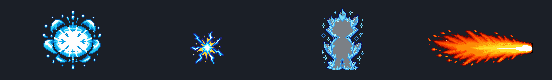

Hero girl weapon FX (water/sling/bubble/lightning/frost/flame). v0.16.1 clarity remake + v0.16.2 sling stone pellet/impact.

- group `girl-fx` · 30 assets · frame 8x8, 12x12, 16x16, 24x24, 24x32, 28x24, 32x28, 32x32, 36x32, 40x18, 40x40, 48x24, 64x16, 64x24, 64x64, 96x40 · key prefix `fx-` · manifest [characters/hero/girl/fx/manifest.json](characters/hero/girl/fx/manifest.json)
- previews: [fx-sheet.png](previews/hero/girl-fx/fx-sheet.png), [sling-pellet-v0162.png](characters/hero/girl/preview/sling-pellet-v0162.png)

| Key | Frames | Size | FPS | Playback | Origin | Notes |
|---|---:|---|---:|---|---|---|
| `fx-bubble-muzzle` | 4 | 32x28 | 12 | once | (1.0, 0.5) |  |
| `fx-bubble-pop` | 6 | 24x24 | 16 | once | (0.5, 0.5) |  |
| `fx-bubble-proj-l` | 4 | 16x16 | 8 | loop | (0.5, 0.5) |  |
| `fx-bubble-proj-m` | 4 | 12x12 | 8 | loop | (0.5, 0.5) |  |
| `fx-bubble-proj-s` | 4 | 8x8 | 8 | loop | (0.5, 0.5) |  |
| `fx-bubble-trap-form` | 6 | 64x64 | 12 | once | (0.5, 1.0) |  |
| `fx-bubble-trap-loop` | 6 | 64x64 | 8 | loop | (0.5, 1.0) |  |
| `fx-bubble-trap-pop` | 6 | 64x64 | 16 | once | (0.5, 1.0) |  |
| `fx-flame-cone` | 6 | 96x40 | 12 | loop | (1.0, 0.5) |  |
| `fx-flame-ground` | 6 | 48x24 | 10 | loop | (0.5, 0.92) |  |
| `fx-flame-impact` | 6 | 40x40 | 14 | once | (0.5, 0.5) |  |
| `fx-flame-muzzle` | 4 | 24x24 | 14 | once | (1.0, 0.5) |  |
| `fx-flame-smoke` | 8 | 32x32 | 12 | loop | (0.5, 0.5) |  |
| `fx-frost-beam` | 4 | 64x16 | 12 | loop | (0.15, 0.5) |  |
| `fx-frost-impact` | 8 | 40x40 | 12 | once | (0.5, 0.83) |  |
| `fx-frost-muzzle` | 4 | 24x32 | 12 | once | (1.0, 0.5) |  |
| `fx-frost-pellet` | 4 | 16x16 | 12 | loop | (0.5, 0.5) |  |
| `fx-frost-shatter` | 10 | 64x64 | 14 | once | (0.5, 0.7) |  |
| `fx-lightning-bolt` | 4 | 48x24 | 16 | loop | (0.18, 0.5) |  |
| `fx-lightning-chain` | 4 | 64x24 | 16 | loop | (0.0, 0.5) |  |
| `fx-lightning-impact` | 6 | 40x40 | 14 | once | (0.5, 0.5) |  |
| `fx-lightning-muzzle` | 4 | 28x24 | 14 | once | (1.0, 0.5) |  |
| `fx-lightning-paralyze` | 6 | 64x64 | 12 | loop | (0.5, 1.0) |  |
| `fx-sling-dizzy` | 8 | 40x18 | 10 | loop | (0.5, 1.0) |  |
| `fx-sling-impact` | 6 | 40x40 | 14 | once | (0.5, 0.5) | v0.16.2: brown/gray stone-chip splash (no fire) |
| `fx-sling-pellet` | 4 | 16x16 | 14 | loop | (0.38, 0.5) | v0.16.2: brown stone/pebble (NOT blue cube); spins; short dust trail east; travel west |
| `fx-water-impact` | 6 | 36x32 | 12 | once | (0.5, 0.69) |  |
| `fx-water-muzzle` | 4 | 28x24 | 12 | once | (1.0, 0.5) |  |
| `fx-water-stream` | 4 | 64x16 | 12 | loop | (0.5, 0.5) |  |
| `fx-water-wet` | 6 | 64x64 | 8 | loop | (0.5, 1.0) |  |

### Player Girl — weapon icons (武器圖示)

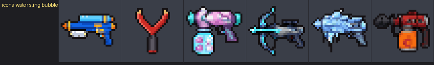

32x32 weapon icons for HUD / shop (single images, load with this.load.image).

- group `girl-icons` · 6 assets · frame 32x32 · key prefix `icon-` · manifest [characters/hero/girl/icons/manifest.json](characters/hero/girl/icons/manifest.json)
- previews: [icons-sheet.png](previews/hero/girl-icons/icons-sheet.png)

| Key | File | Size | Type | Notes |
|---|---|---|---|---|
| `icon-water` | [icon-water.png](characters/hero/girl/icons/icon-water.png) | 32x32 | icon | Player Girl — weapon icons: water (32x32 image). |
| `icon-sling` | [icon-sling.png](characters/hero/girl/icons/icon-sling.png) | 32x32 | icon | Player Girl — weapon icons: sling (32x32 image). |
| `icon-bubble` | [icon-bubble.png](characters/hero/girl/icons/icon-bubble.png) | 32x32 | icon | Player Girl — weapon icons: bubble (32x32 image). |
| `icon-lightning` | [icon-lightning.png](characters/hero/girl/icons/icon-lightning.png) | 32x32 | icon | Player Girl — weapon icons: lightning (32x32 image). |
| `icon-frost` | [icon-frost.png](characters/hero/girl/icons/icon-frost.png) | 32x32 | icon | Player Girl — weapon icons: frost (32x32 image). |
| `icon-flame` | [icon-flame.png](characters/hero/girl/icons/icon-flame.png) | 32x32 | icon | Player Girl — weapon icons: flame (32x32 image). |

## Pets

### Jade / 翠火 — Ancient (翠火·成年)

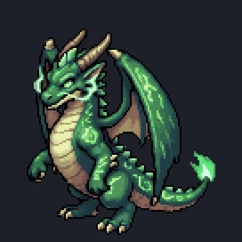

Green Dragon. Ancient form (128px). Skill: Apocalyptic Flame / 末日烈焰. Faces WEST.

- group `dragon-ancient` · 4 assets · frame 128x128 · key prefix `pet-dragon-ancient-` · manifest [pets/dragon/ancient/manifest.json](pets/dragon/ancient/manifest.json)

| Key | Frames | Size | FPS | Playback | Origin | Notes |
|---|---:|---|---:|---|---|---|
| `pet-dragon-ancient-idle` | 6 | 128x128 | 6 | loop | (0.5, 1.0) |  |
| `pet-dragon-ancient-move` | 8 | 128x128 | 10 | loop | (0.5, 1.0) |  |
| `pet-dragon-ancient-skill` | 12 | 128x128 | 10 | once | (0.5, 1.0) | fx: `fx-pet-dragon-apocalypse-flame` |
| `pet-dragon-ancient-hurt` | 4 | 128x128 | 10 | once | (0.5, 1.0) |  |

### Jade / 翠火 — Baby (翠火·幼年)

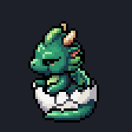

Green Dragon. Baby form (48px). Skill: Smoke Breath / 煙霧吐息. Faces WEST. Sleep: settle→loop behind barricade after recall; wake via idle/move on resummon (no teleport).

- group `dragon-baby` · 6 assets · frame 48x48 · key prefix `pet-dragon-baby-` · manifest [pets/dragon/baby/manifest.json](pets/dragon/baby/manifest.json)

| Key | Frames | Size | FPS | Playback | Origin | Notes |
|---|---:|---|---:|---|---|---|
| `pet-dragon-baby-idle` | 6 | 48x48 | 6 | loop | (0.5, 1.0) |  |
| `pet-dragon-baby-move` | 6 | 48x48 | 10 | loop | (0.5, 1.0) |  |
| `pet-dragon-baby-skill` | 8 | 48x48 | 10 | once | (0.5, 1.0) | fx: `fx-pet-dragon-smoke-breath` |
| `pet-dragon-baby-hurt` | 4 | 48x48 | 10 | once | (0.5, 1.0) |  |
| `pet-dragon-baby-sleep-start` | 4 | 48x48 | 8 | once | (0.5, 1.0) |  |
| `pet-dragon-baby-sleep` | 10 | 48x48 | 6 | start 0-3 once, loop 4-9 | (0.5, 1.0) |  |

### Jade / 翠火 — FX (翠火·特效)

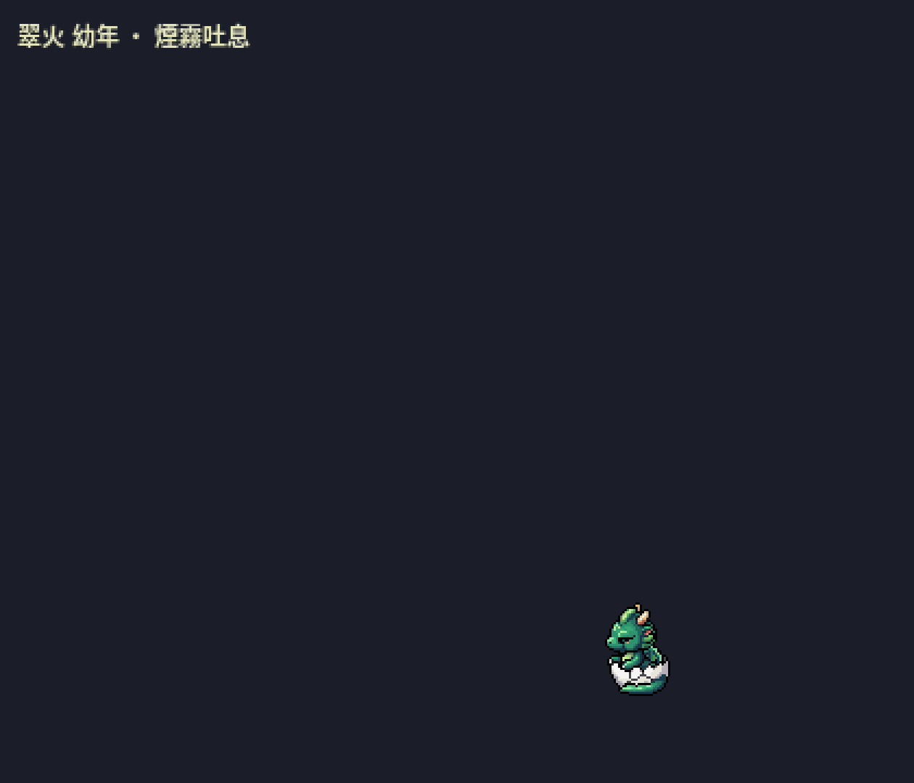

Standalone skill FX for Green Dragon. Travel west. Evolve FX included.

- group `dragon-fx` · 5 assets · frame 40x24, 64x64, 80x48, 128x128, 256x96 · key prefix `fx-pet-dragon-` · manifest [pets/dragon/fx/manifest.json](pets/dragon/fx/manifest.json)

| Key | Frames | Size | FPS | Playback | Origin | Notes |
|---|---:|---|---:|---|---|---|
| `fx-pet-dragon-smoke-breath` | 10 | 80x48 | 12 | once | (0.975, 0.5) | Small toxic smoke cloud puffed west from the mouth (cone ≈ 60 px). Origin = mouth. Gameplay: slow + light poison on zombies in the cloud. |
| `fx-pet-dragon-fireball` | 4 | 40x24 | 12 | loop | (0.225, 0.5) | Projectile: green fireball flying west (−x) ≈ 5 px/frame at 60 fps. Origin = ball centre. On hit spawn fx-pet-dragon-fireball-impact (splash ≈ 28 px). |
| `fx-pet-dragon-fireball-impact` | 8 | 64x64 | 14 | once | (0.5, 0.5) | Green fireball explosion, splash radius ≈ 28 px. Centre on the hit point. |
| `fx-pet-dragon-apocalypse-flame` | 14 | 256x96 | 12 | start 0-3 once, loop 4-9, end 10-13 once | (0.9844, 0.5) | Sustained jade-fire breath beam. Origin = mouth; reaches ≈ 240 px west, ≈ 80 px wide at the far end. Start 0–3 (beam grows), loop 4–9 while breathing (seamless), end 10–13 (beam detaches and burns out). Damage tick every ~0.2 s to zombies inside the beam. |
| `fx-pet-dragon-evolve` | 12 | 128x128 | 12 | once | (0.5, 0.921875) | Form-change burst. Origin = pet feet (y=118). Play over the pet; swap the pet texture on frame 6 (the flash). |

### Jade / 翠火 — Young (翠火·青年)

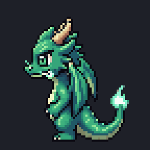

Green Dragon. Young form (64px). Skill: Scorching Fireball / 灼熱火球. Faces WEST.

- group `dragon-young` · 4 assets · frame 64x64 · key prefix `pet-dragon-young-` · manifest [pets/dragon/young/manifest.json](pets/dragon/young/manifest.json)

| Key | Frames | Size | FPS | Playback | Origin | Notes |
|---|---:|---|---:|---|---|---|
| `pet-dragon-young-idle` | 6 | 64x64 | 6 | loop | (0.5, 1.0) |  |
| `pet-dragon-young-move` | 8 | 64x64 | 10 | loop | (0.5, 1.0) |  |
| `pet-dragon-young-skill` | 8 | 64x64 | 10 | once | (0.5, 1.0) | fx: `fx-pet-dragon-fireball`, `fx-pet-dragon-fireball-impact` |
| `pet-dragon-young-hurt` | 4 | 64x64 | 10 | once | (0.5, 1.0) |  |

### Leo / 雷歐 — Ancient (雷歐·成年)

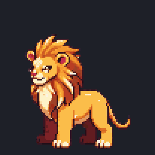

Golden Lion 金獅. Ancient form (96px). Skill: Sunder Strike / 裂地猛擊. Faces WEST.

- group `lion-ancient` · 4 assets · frame 96x96 · key prefix `pet-lion-ancient-` · manifest [pets/lion/ancient/manifest.json](pets/lion/ancient/manifest.json)

| Key | Frames | Size | FPS | Playback | Origin | Notes |
|---|---:|---|---:|---|---|---|
| `pet-lion-ancient-idle` | 8 | 96x96 | 8 | loop | (0.5, 1.0) |  |
| `pet-lion-ancient-move` | 6 | 96x96 | 12 | loop | (0.5, 1.0) |  |
| `pet-lion-ancient-skill` | 8 | 96x96 | 12 | once | (0.5, 1.0) | fx: `fx-pet-lion-sunder-strike` |
| `pet-lion-ancient-hurt` | 4 | 96x96 | 10 | once | (0.5, 1.0) |  |

### Leo / 雷歐 — Baby (雷歐·幼年)

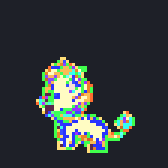

Golden Lion 金獅. Baby form (48px). Skill: Cub Pounce / 幼獅飛撲. Faces WEST. Sleep: settle→loop behind barricade after recall; wake via idle/move on resummon (no teleport).

- group `lion-baby` · 6 assets · frame 48x48 · key prefix `pet-lion-baby-` · manifest [pets/lion/baby/manifest.json](pets/lion/baby/manifest.json)

| Key | Frames | Size | FPS | Playback | Origin | Notes |
|---|---:|---|---:|---|---|---|
| `pet-lion-baby-idle` | 8 | 48x48 | 8 | loop | (0.5, 1.0) |  |
| `pet-lion-baby-move` | 6 | 48x48 | 12 | loop | (0.5, 1.0) |  |
| `pet-lion-baby-skill` | 8 | 48x48 | 12 | once | (0.5, 1.0) | fx: `fx-pet-lion-pounce-slash` |
| `pet-lion-baby-hurt` | 4 | 48x48 | 10 | once | (0.5, 1.0) |  |
| `pet-lion-baby-sleep-start` | 4 | 48x48 | 8 | once | (0.5, 1.0) |  |
| `pet-lion-baby-sleep` | 10 | 48x48 | 6 | start 0-3 once, loop 4-9 | (0.5, 1.0) |  |

### Leo / 雷歐 — FX (雷歐·特效)

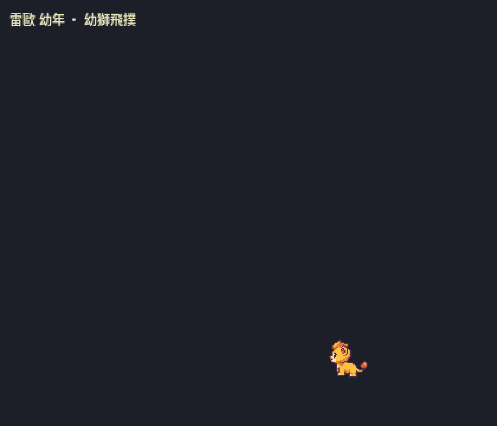

Standalone skill FX for Golden Lion 金獅. Travel west. Evolve FX included.

- group `lion-fx` · 4 assets · frame 48x48, 128x128, 160x80, 192x112 · key prefix `fx-pet-lion-` · manifest [pets/lion/fx/manifest.json](pets/lion/fx/manifest.json)

| Key | Frames | Size | FPS | Playback | Origin | Notes |
|---|---:|---|---:|---|---|---|
| `fx-pet-lion-pounce-slash` | 6 | 48x48 | 16 | once | (0.5, 0.5) | Claw slash on landing; centre on the target (≈ 20 px in front of the cub). Single-target melee. |
| `fx-pet-lion-roar-wave` | 8 | 160x80 | 12 | once | (0.975, 0.5) | Stun cone: golden sonic rings travel west from the mouth, range ≈ 150 px, half-angle ≈ 28°. Origin = mouth. Stun zombies inside the cone on frames 2–6 (≈ 1.5 s). |
| `fx-pet-lion-sunder-strike` | 10 | 192x112 | 12 | once | (0.5, 0.875) | Ground-slam AoE at the landing point: gold ground cracks with lightning rising out of them, radius ≈ 90 px along the ground. Origin = impact point on the ground. Damage + short stun on frame 1. |
| `fx-pet-lion-evolve` | 12 | 128x128 | 12 | once | (0.5, 0.921875) | Form-change burst. Origin = pet feet (y=118). Play over the pet; swap the pet texture on frame 6 (the flash). |

### Leo / 雷歐 — Young (雷歐·青年)

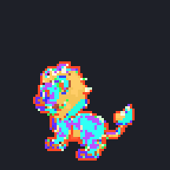

Golden Lion 金獅. Young form (64px). Skill: Lion Roar / 雄獅咆哮. Faces WEST.

- group `lion-young` · 4 assets · frame 64x64 · key prefix `pet-lion-young-` · manifest [pets/lion/young/manifest.json](pets/lion/young/manifest.json)

| Key | Frames | Size | FPS | Playback | Origin | Notes |
|---|---:|---|---:|---|---|---|
| `pet-lion-young-idle` | 8 | 64x64 | 8 | loop | (0.5, 1.0) |  |
| `pet-lion-young-move` | 6 | 64x64 | 12 | loop | (0.5, 1.0) |  |
| `pet-lion-young-skill` | 8 | 64x64 | 12 | once | (0.5, 1.0) | fx: `fx-pet-lion-roar-wave` |
| `pet-lion-young-hurt` | 4 | 64x64 | 10 | once | (0.5, 1.0) |  |

### Momo / 墨墨 — Ancient (墨墨·成年)

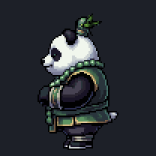

Black Panda 墨熊貓. Ancient form (96px). Skill: Chi Blast / 氣功波. Faces WEST.

- group `panda-ancient` · 4 assets · frame 96x96 · key prefix `pet-panda-ancient-` · manifest [pets/panda/ancient/manifest.json](pets/panda/ancient/manifest.json)

| Key | Frames | Size | FPS | Playback | Origin | Notes |
|---|---:|---|---:|---|---|---|
| `pet-panda-ancient-idle` | 6 | 96x96 | 6 | loop | (0.5, 1.0) |  |
| `pet-panda-ancient-move` | 6 | 96x96 | 10 | loop | (0.5, 1.0) |  |
| `pet-panda-ancient-skill` | 8 | 96x96 | 10 | once | (0.5, 1.0) | fx: `fx-pet-panda-chi-blast` |
| `pet-panda-ancient-hurt` | 4 | 96x96 | 10 | once | (0.5, 1.0) |  |

### Momo / 墨墨 — Baby (墨墨·幼年)

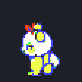

Black Panda 墨熊貓. Baby form (48px). Skill: Roll Raid / 滾動突襲. Faces WEST. Sleep: settle→loop behind barricade after recall; wake via idle/move on resummon (no teleport).

- group `panda-baby` · 6 assets · frame 48x48 · key prefix `pet-panda-baby-` · manifest [pets/panda/baby/manifest.json](pets/panda/baby/manifest.json)

| Key | Frames | Size | FPS | Playback | Origin | Notes |
|---|---:|---|---:|---|---|---|
| `pet-panda-baby-idle` | 6 | 48x48 | 8 | loop | (0.5, 1.0) |  |
| `pet-panda-baby-move` | 6 | 48x48 | 10 | loop | (0.5, 1.0) |  |
| `pet-panda-baby-skill` | 8 | 48x48 | 12 | once | (0.5, 1.0) | fx: `fx-pet-panda-roll-dust`, `fx-pet-panda-roll-impact` |
| `pet-panda-baby-hurt` | 4 | 48x48 | 10 | once | (0.5, 1.0) |  |
| `pet-panda-baby-sleep-start` | 4 | 48x48 | 8 | once | (0.5, 1.0) |  |
| `pet-panda-baby-sleep` | 10 | 48x48 | 6 | start 0-3 once, loop 4-9 | (0.5, 1.0) |  |

### Momo / 墨墨 — FX (墨墨·特效)

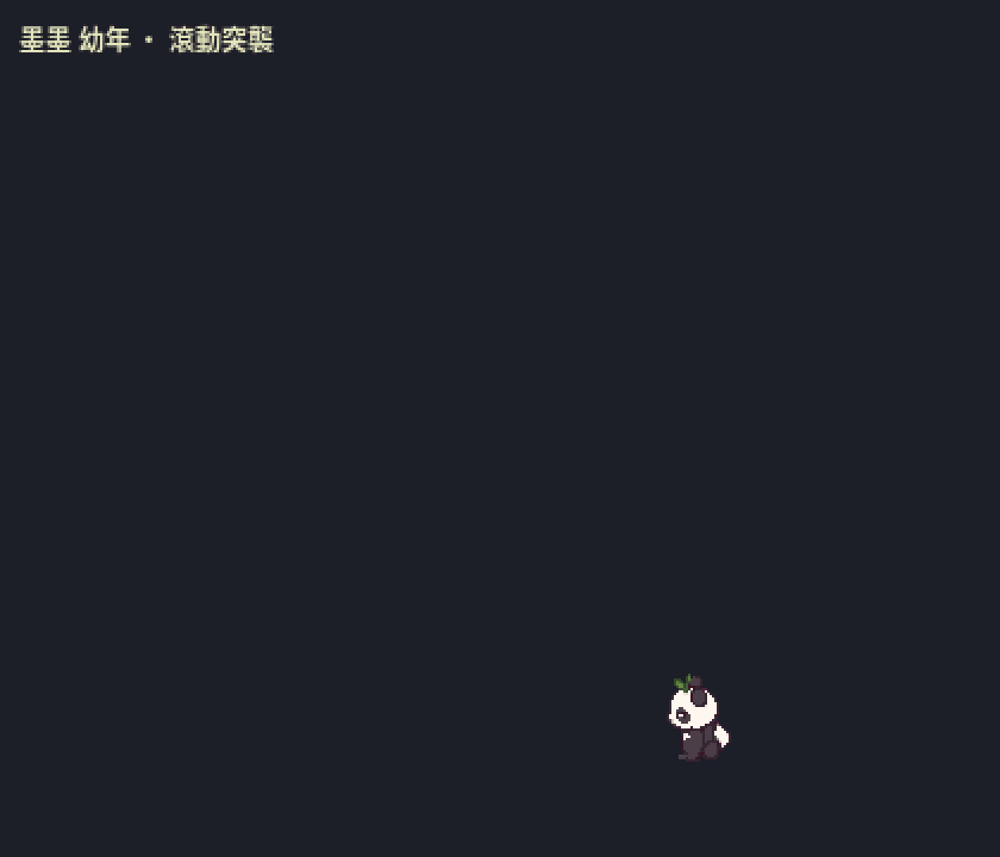

Standalone skill FX for Black Panda 墨熊貓. Travel west. Evolve FX included.

- group `panda-fx` · 5 assets · frame 48x32, 48x48, 112x72, 128x128, 224x112 · key prefix `fx-pet-panda-` · manifest [pets/panda/fx/manifest.json](pets/panda/fx/manifest.json)

| Key | Frames | Size | FPS | Playback | Origin | Notes |
|---|---:|---|---:|---|---|---|
| `fx-pet-panda-roll-dust` | 6 | 48x32 | 12 | once | (0.5, 0.9375) | Dust + bamboo-leaf puff left behind the rolling panda (spawn at the panda origin every 3–4 cast frames; does not move). |
| `fx-pet-panda-roll-impact` | 6 | 48x48 | 16 | once | (0.5, 0.5) | Jade impact star when the rolling panda hits a zombie (knockback). Centre on contact point. |
| `fx-pet-panda-bamboo-sweep` | 8 | 112x72 | 14 | once | (0.7321, 0.5556) | Crescent sweep in front (west) of the panda, top → bottom, reach ≈ 50 px from the pivot (≈ 100 px wide arc). Melee AoE + knockback on frames 1–4. Origin = swing pivot (place at the panda chest). Bamboo leaves fly off the edge. |
| `fx-pet-panda-chi-blast` | 12 | 224x112 | 12 | once | (0.5, 0.8928571428571429) | AoE shockwave around the panda: radius ≈ 110 px (x) × 37 px (y ground ellipse). Origin = ground under the panda. Frames 0–3 charge; damage + knockback when the ring passes (frames 4–9); bamboo shards fly outward. |
| `fx-pet-panda-evolve` | 12 | 128x128 | 12 | once | (0.5, 0.921875) | Form-change burst. Origin = pet feet (y=118). Play over the pet; swap the pet texture on frame 6 (the flash). |

### Momo / 墨墨 — Young (墨墨·青年)

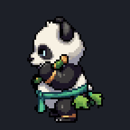

Black Panda 墨熊貓. Young form (64px). Skill: Bamboo Sweep / 竹林橫掃. Faces WEST.

- group `panda-young` · 4 assets · frame 64x64 · key prefix `pet-panda-young-` · manifest [pets/panda/young/manifest.json](pets/panda/young/manifest.json)

| Key | Frames | Size | FPS | Playback | Origin | Notes |
|---|---:|---|---:|---|---|---|
| `pet-panda-young-idle` | 6 | 64x64 | 8 | loop | (0.5, 1.0) |  |
| `pet-panda-young-move` | 6 | 64x64 | 10 | loop | (0.5, 1.0) |  |
| `pet-panda-young-skill` | 8 | 64x64 | 12 | once | (0.5, 1.0) | fx: `fx-pet-panda-bamboo-sweep` |
| `pet-panda-young-hurt` | 4 | 64x64 | 10 | once | (0.5, 1.0) |  |

### Azure / 藍羽 — Ancient (藍羽·成年)

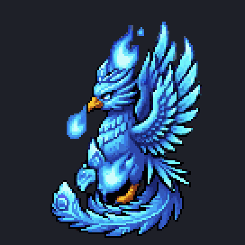

Blue Phoenix 藍焰鳳凰. Ancient form (128px). Skill: Blazing Rebirth / 烈焰重生. Faces WEST.

- group `phoenix-ancient` · 4 assets · frame 128x128 · key prefix `pet-phoenix-ancient-` · manifest [pets/phoenix/ancient/manifest.json](pets/phoenix/ancient/manifest.json)

| Key | Frames | Size | FPS | Playback | Origin | Notes |
|---|---:|---|---:|---|---|---|
| `pet-phoenix-ancient-idle` | 6 | 128x128 | 6 | loop | (0.5, 1.0) |  |
| `pet-phoenix-ancient-move` | 6 | 128x128 | 10 | loop | (0.5, 1.0) |  |
| `pet-phoenix-ancient-skill` | 8 | 128x128 | 10 | once | (0.5, 1.0) | fx: `fx-pet-phoenix-blazing-rebirth` |
| `pet-phoenix-ancient-hurt` | 4 | 128x128 | 10 | once | (0.5, 1.0) |  |

### Azure / 藍羽 — Baby (藍羽·幼年)

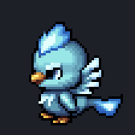

Blue Phoenix 藍焰鳳凰. Baby form (48px). Skill: Spark Feather / 閃光羽落. Faces WEST. Sleep: settle→loop behind barricade after recall; wake via idle/move on resummon (no teleport).

- group `phoenix-baby` · 6 assets · frame 48x48 · key prefix `pet-phoenix-baby-` · manifest [pets/phoenix/baby/manifest.json](pets/phoenix/baby/manifest.json)

| Key | Frames | Size | FPS | Playback | Origin | Notes |
|---|---:|---|---:|---|---|---|
| `pet-phoenix-baby-idle` | 6 | 48x48 | 8 | loop | (0.5, 1.0) |  |
| `pet-phoenix-baby-move` | 6 | 48x48 | 10 | loop | (0.5, 1.0) |  |
| `pet-phoenix-baby-skill` | 8 | 48x48 | 10 | once | (0.5, 1.0) | fx: `fx-pet-phoenix-spark-feather`, `fx-pet-phoenix-spark-feather-hit` |
| `pet-phoenix-baby-hurt` | 4 | 48x48 | 10 | once | (0.5, 1.0) |  |
| `pet-phoenix-baby-sleep-start` | 4 | 48x48 | 8 | once | (0.5, 1.0) |  |
| `pet-phoenix-baby-sleep` | 10 | 48x48 | 6 | start 0-3 once, loop 4-9 | (0.5, 1.0) |  |

### Azure / 藍羽 — FX (藍羽·特效)

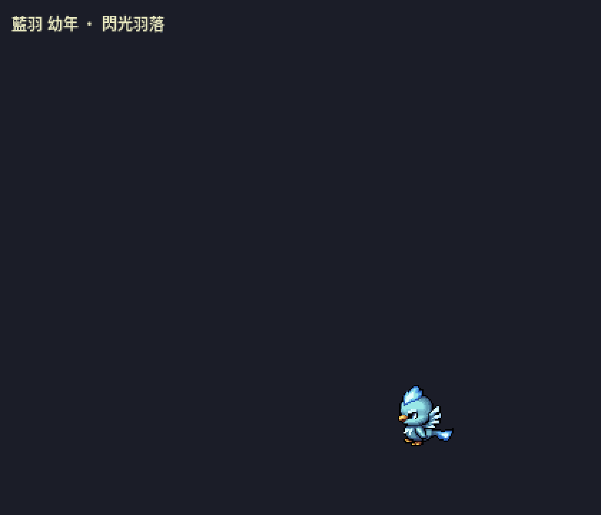

Standalone skill FX for Blue Phoenix 藍焰鳳凰. Travel west. Evolve FX included.

- group `phoenix-fx` · 6 assets · frame 24x48, 32x16, 32x32, 48x32, 128x128, 192x128 · key prefix `fx-pet-phoenix-` · manifest [pets/phoenix/fx/manifest.json](pets/phoenix/fx/manifest.json)

| Key | Frames | Size | FPS | Playback | Origin | Notes |
|---|---:|---|---:|---|---|---|
| `fx-pet-phoenix-spark-feather` | 4 | 32x16 | 12 | loop | (0.19, 0.5) | Projectile: flies west (−x) ~6 px/frame at 60 fps (≈360 px/s). Origin = feather tip. Fire 3 in a small fan (−8°, 0°, +8°). |
| `fx-pet-phoenix-spark-feather-hit` | 6 | 32x32 | 16 | once | (0.5, 0.5) | Impact when a spark feather hits; centre on the zombie hit point. |
| `fx-pet-phoenix-rain-bolt` | 4 | 24x48 | 12 | loop | (0.33, 0.79) | Falling blue fire-feather. Origin = head. Spawn 60–90 px above ground in an area 40–140 px west of the phoenix; move (−2, +6) px/frame at 60 fps; on reaching the ground spawn fx-pet-phoenix-rain-impact. |
| `fx-pet-phoenix-rain-impact` | 6 | 48x32 | 14 | once | (0.5, 0.875) | Ground impact of a rain bolt (small AoE, ~20 px radius). Origin = ground contact point. |
| `fx-pet-phoenix-blazing-rebirth` | 12 | 192x128 | 12 | once | (0.5, 0.9062) | AoE around the phoenix: radius ≈ 95 px (x) × 27 px (y ground ellipse); flame plume up to ≈ 90 px high. Origin = ground under the phoenix. Frames 0–2 gather (no damage), burst/damage on frame 3, burning ring 4–10. Can double as the revive/heal burst. |
| `fx-pet-phoenix-evolve` | 12 | 128x128 | 12 | once | (0.5, 0.921875) | Form-change burst. Origin = pet feet (y=118). Play over the pet; swap the pet texture on frame 6 (the flash). |

### Azure / 藍羽 — Young (藍羽·青年)

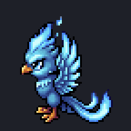

Blue Phoenix 藍焰鳳凰. Young form (64px). Skill: Phoenix Rain / 鳳凰火雨. Faces WEST.

- group `phoenix-young` · 4 assets · frame 64x64 · key prefix `pet-phoenix-young-` · manifest [pets/phoenix/young/manifest.json](pets/phoenix/young/manifest.json)

| Key | Frames | Size | FPS | Playback | Origin | Notes |
|---|---:|---|---:|---|---|---|
| `pet-phoenix-young-idle` | 6 | 64x64 | 8 | loop | (0.5, 1.0) |  |
| `pet-phoenix-young-move` | 6 | 64x64 | 10 | loop | (0.5, 1.0) |  |
| `pet-phoenix-young-skill` | 8 | 64x64 | 10 | once | (0.5, 1.0) | fx: `fx-pet-phoenix-rain-bolt`, `fx-pet-phoenix-rain-impact` |
| `pet-phoenix-young-hurt` | 4 | 64x64 | 10 | once | (0.5, 1.0) |  |

### Pet UI HUD — heads, bars, skill orbs (寵物 HUD（大頭／長條／寶珠）)

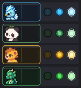

Stage pet HUD pack. Heads 48x48 (v0.20.x). Bars 64x32 with head composited left (v0.21.0). Skill orbs 16x16 dark/lit/flash per pet (v0.21.0). Grey-dead bar/head is code desaturate. CD ring drawn in code over orb. Origin: heads center; bars left-middle [0, 0.5]; orbs center.

- group `pet-ui-hud` · 20 assets · frame 16x16, 48x48, 64x32 · key prefix `ui-pet-` · manifest [pets/ui/manifest.json](pets/ui/manifest.json)
- previews: [heads-sheet.png](previews/pets/pet-heads/heads-sheet.png), [hud-sheet.png](previews/pets/pet-hud/hud-sheet.png), [hud-sheet-x4.png](previews/pets/pet-hud/hud-sheet-x4.png)

| Key | File | Size | Type | Notes |
|---|---|---|---|---|
| `ui-pet-phoenix-head` | [ui-pet-phoenix-head.png](pets/ui/ui-pet-phoenix-head.png) | 48x48 | icon | Azure / 藍羽 baby head — cyan phoenix crest, yellow beak. |
| `ui-pet-panda-head` | [ui-pet-panda-head.png](pets/ui/ui-pet-panda-head.png) | 48x48 | icon | Ink / 墨墨 baby head — black-white panda with green sprout. |
| `ui-pet-lion-head` | [ui-pet-lion-head.png](pets/ui/ui-pet-lion-head.png) | 48x48 | icon | Leo / 雷歐 baby head — golden lion with orange mane tuft. |
| `ui-pet-dragon-head` | [ui-pet-dragon-head.png](pets/ui/ui-pet-dragon-head.png) | 48x48 | icon | Jadefire / 翠火 baby head — green dragon with cream horn. |
| `ui-pet-phoenix-bar` | [ui-pet-phoenix-bar.png](pets/ui/ui-pet-phoenix-bar.png) | 64x32 | icon | origin [0, 0.5] — place by left edge so orbs sit to the right of the bar |
| `ui-pet-panda-bar` | [ui-pet-panda-bar.png](pets/ui/ui-pet-panda-bar.png) | 64x32 | icon | origin [0, 0.5] |
| `ui-pet-lion-bar` | [ui-pet-lion-bar.png](pets/ui/ui-pet-lion-bar.png) | 64x32 | icon | origin [0, 0.5] |
| `ui-pet-dragon-bar` | [ui-pet-dragon-bar.png](pets/ui/ui-pet-dragon-bar.png) | 64x32 | icon | origin [0, 0.5] |
| `ui-pet-orb-phoenix-dark` | [ui-pet-orb-phoenix-dark.png](pets/ui/ui-pet-orb-phoenix-dark.png) | 16x16 | icon | Phoenix skill orb — dark/empty (cyan-fire family). |
| `ui-pet-orb-phoenix-lit` | [ui-pet-orb-phoenix-lit.png](pets/ui/ui-pet-orb-phoenix-lit.png) | 16x16 | icon | Phoenix skill orb — lit/ready. Overlay CD ring in code. |
| `ui-pet-orb-phoenix-flash` | [ui-pet-orb-phoenix-flash.png](pets/ui/ui-pet-orb-phoenix-flash.png) | 16x16 | icon | Phoenix skill orb — flash/ready blink frame (Gameplay: 1s then auto-cast). |
| `ui-pet-orb-panda-dark` | [ui-pet-orb-panda-dark.png](pets/ui/ui-pet-orb-panda-dark.png) | 16x16 | icon | Panda skill orb — dark/empty (jade family). |
| `ui-pet-orb-panda-lit` | [ui-pet-orb-panda-lit.png](pets/ui/ui-pet-orb-panda-lit.png) | 16x16 | icon | Panda skill orb — lit/ready. |
| `ui-pet-orb-panda-flash` | [ui-pet-orb-panda-flash.png](pets/ui/ui-pet-orb-panda-flash.png) | 16x16 | icon | Panda skill orb — flash blink frame. |
| `ui-pet-orb-lion-dark` | [ui-pet-orb-lion-dark.png](pets/ui/ui-pet-orb-lion-dark.png) | 16x16 | icon | Lion skill orb — dark/empty (gold-electric family). |
| `ui-pet-orb-lion-lit` | [ui-pet-orb-lion-lit.png](pets/ui/ui-pet-orb-lion-lit.png) | 16x16 | icon | Lion skill orb — lit/ready. |
| `ui-pet-orb-lion-flash` | [ui-pet-orb-lion-flash.png](pets/ui/ui-pet-orb-lion-flash.png) | 16x16 | icon | Lion skill orb — flash blink frame. |
| `ui-pet-orb-dragon-dark` | [ui-pet-orb-dragon-dark.png](pets/ui/ui-pet-orb-dragon-dark.png) | 16x16 | icon | Dragon skill orb — dark/empty (green-poison family). |
| `ui-pet-orb-dragon-lit` | [ui-pet-orb-dragon-lit.png](pets/ui/ui-pet-orb-dragon-lit.png) | 16x16 | icon | Dragon skill orb — lit/ready. |
| `ui-pet-orb-dragon-flash` | [ui-pet-orb-dragon-flash.png](pets/ui/ui-pet-orb-dragon-flash.png) | 16x16 | icon | Dragon skill orb — flash blink frame. |

## UI

### Unified UI Kit — HUD fonts, HP bars, panels, buttons, tip icons (統一 UI 套件（字體／血條／面板／按鈕／提示圖示）)

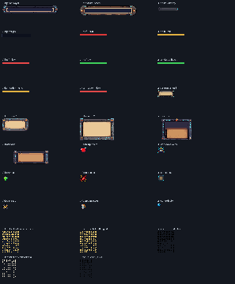

v0.22.0 UI kit from 2-PixelLab Bot. Stone/parchment/cyan-glow/orange-gem style matching title screen. Latin font atlases only (no CJK). Prefer ui-font-hud-bold-atlas-outlined and *-cream. Pet HUD stays under pets/ui. TTF companions: assets/library/ui/fonts/ui-font-hud-bold.ttf + ui-font-hud-tiny.ttf (not indexed as textures). Includes title splash ui-title-bg (688×384 native) + ui-title-bg-hd (1280×720 upscale) from 2-PixelLab Bot. v0.22.1: pet float GO!/Back! callouts under floats/.

- group `hud-kit` · 41 assets · frame 16x16, 32x32, 40x16, 64x16, 64x80, 73x33, 80x32, 85x44, 96x32, 106x39, 116x56, 120x10, 128x16, 128x32, 128x160, 160x64, 170x88, 212x78, 234x148, 248x36, 251x45, 256x64, 512x192, 512x288, 688x384, 1280x720 · key prefix `ui-` · manifest [ui/manifest.json](ui/manifest.json)
- previews: [ui-kit-sheet.png](previews/ui/hud-kit/ui-kit-sheet.png), [ui-title-bg-preview.png](previews/ui/hud-kit/ui-title-bg-preview.png), [ui-float-go-back-sheet.png](previews/ui/hud-kit/ui-float-go-back-sheet.png)

| Key | File | Size | Type | Notes |
|---|---|---|---|---|
| `ui-hp-bar-player` | [ui-hp-bar-player.png](ui/bars/ui-hp-bar-player.png) | 248x36 | icon | Player HP stone frame, parchment rim, cyan accents, orange gems. |
| `ui-hp-bar-barricade` | [ui-hp-bar-barricade.png](ui/bars/ui-hp-bar-barricade.png) | 251x45 | icon | Barricade HP wood-brown + stone frame. |
| `ui-hp-bar-enemy` | [ui-hp-bar-enemy.png](ui/bars/ui-hp-bar-enemy.png) | 96x32 | icon | Compact enemy / world HP frame. |
| `ui-hp-trough` | [ui-hp-trough.png](ui/bars/ui-hp-trough.png) | 128x16 | icon | Empty HP trough strip (stretch). |
| `ui-hp-fill-full` | [ui-hp-fill-full.png](ui/bars/ui-hp-fill-full.png) | 120x10 | icon | HP fill red (full). |
| `ui-hp-fill-mid` | [ui-hp-fill-mid.png](ui/bars/ui-hp-fill-mid.png) | 120x10 | icon | HP fill yellow (mid). |
| `ui-hp-fill-low` | [ui-hp-fill-low.png](ui/bars/ui-hp-fill-low.png) | 120x10 | icon | HP fill dark red (low). |
| `ui-hp-fill-ok` | [ui-hp-fill-ok.png](ui/bars/ui-hp-fill-ok.png) | 120x10 | icon | HP fill green (ok). |
| `ui-barricade-fill-ok` | [ui-barricade-fill-ok.png](ui/bars/ui-barricade-fill-ok.png) | 120x10 | icon | Barricade fill green. |
| `ui-barricade-fill-mid` | [ui-barricade-fill-mid.png](ui/bars/ui-barricade-fill-mid.png) | 120x10 | icon | Barricade fill yellow. |
| `ui-barricade-fill-low` | [ui-barricade-fill-low.png](ui/bars/ui-barricade-fill-low.png) | 120x10 | icon | Barricade fill red. |
| `ui-dialog-panel` | [ui-dialog-panel.png](ui/panels/ui-dialog-panel.png) | 512x288 | icon | Stone dialog window with parchment inset. |
| `ui-toast-panel` | [ui-toast-panel.png](ui/toasts/ui-toast-panel.png) | 512x192 | icon | Wide toast / tip banner with cyan rune pillars. |
| `ui-btn-parchment` | [ui-btn-parchment.png](ui/buttons/ui-btn-parchment.png) | 73x33 | icon | Empty parchment button (label via font). |
| `ui-btn-piece-1` | [ui-btn-piece-1.png](ui/buttons/ui-btn-piece-1.png) | 116x56 | icon | Small UI frame piece. |
| `ui-btn-piece-2` | [ui-btn-piece-2.png](ui/buttons/ui-btn-piece-2.png) | 234x148 | icon | Large panel piece (9-slice candidate). |
| `ui-icon-hp-heart` | [ui-icon-hp-heart.png](ui/icons/ui-icon-hp-heart.png) | 32x32 | icon | HP heart tip icon. |
| `ui-icon-wave-warn` | [ui-icon-wave-warn.png](ui/icons/ui-icon-wave-warn.png) | 32x32 | icon | Wave warning tip icon. |
| `ui-icon-heal` | [ui-icon-heal.png](ui/icons/ui-icon-heal.png) | 32x32 | icon | Heal tip icon. |
| `ui-icon-damage` | [ui-icon-damage.png](ui/icons/ui-icon-damage.png) | 32x32 | icon | Damage tip icon. |
| `ui-icon-pause` | [ui-icon-pause.png](ui/icons/ui-icon-pause.png) | 32x32 | icon | Pause tip icon. |
| `ui-icon-ready` | [ui-icon-ready.png](ui/icons/ui-icon-ready.png) | 32x32 | icon | Ready tip icon. |
| `ui-icon-gameover` | [ui-icon-gameover.png](ui/icons/ui-icon-gameover.png) | 32x32 | icon | Game over tip icon. |
| `ui-icon-select-x` | [ui-icon-select-x.png](ui/icons/ui-icon-select-x.png) | 16x16 | icon | Select / close X icon. |
| `ui-font-hud-bold-atlas` | [ui-font-hud-bold-atlas.png](ui/fonts/ui-font-hud-bold-atlas.png) | 128x160 | icon | HUD bold font atlas black silhouettes (tint in engine). Glyph 16px, 10x8. |
| `ui-font-hud-bold-atlas-gold` | [ui-font-hud-bold-atlas-gold.png](ui/fonts/ui-font-hud-bold-atlas-gold.png) | 128x160 | icon | HUD bold atlas cream-gold fill. |
| `ui-font-hud-bold-atlas-outlined` | [ui-font-hud-bold-atlas-outlined.png](ui/fonts/ui-font-hud-bold-atlas-outlined.png) | 128x160 | icon | Prefer for HUD — gold fill + navy outline. |
| `ui-font-hud-tiny-atlas` | [ui-font-hud-tiny-atlas.png](ui/fonts/ui-font-hud-tiny-atlas.png) | 64x80 | icon | HUD tiny font atlas black silhouettes. Glyph 8px. |
| `ui-font-hud-tiny-atlas-cream` | [ui-font-hud-tiny-atlas-cream.png](ui/fonts/ui-font-hud-tiny-atlas-cream.png) | 64x80 | icon | HUD tiny atlas cream tint for small labels. |
| `ui-title-bg` | [ui-title-bg.png](ui/title/ui-title-bg.png) | 688x384 | image | Title splash Zombie vs My Buddy — native night campus + girl + pets (688×384). |
| `ui-title-bg-hd` | [ui-title-bg-hd.png](ui/title/ui-title-bg-hd.png) | 1280x720 | image | Title splash upscale 1280×720 (optional HD). Prefer ui-title-bg for pixel-perfect. |
| `ui-float-go` | [ui-float-go.png](ui/floats/ui-float-go.png) | 80x32 | icon | GO! cream-gold + navy outline; prefer for summon. |
| `ui-float-go-hd` | [ui-float-go-hd.png](ui/floats/ui-float-go-hd.png) | 160x64 | icon | 2× GO! |
| `ui-float-go-sm` | [ui-float-go-sm.png](ui/floats/ui-float-go-sm.png) | 40x16 | icon | Half-scale GO! |
| `ui-float-back` | [ui-float-back.png](ui/floats/ui-float-back.png) | 128x32 | icon | Back! cream-gold + navy outline; prefer for recall. |
| `ui-float-back-hd` | [ui-float-back-hd.png](ui/floats/ui-float-back-hd.png) | 256x64 | icon | 2× Back! |
| `ui-float-back-sm` | [ui-float-back-sm.png](ui/floats/ui-float-back-sm.png) | 64x16 | icon | Half-scale Back! |
| `ui-float-go-burst` | [ui-float-go-burst.png](ui/floats/ui-float-go-burst.png) | 85x44 | icon | Optional decorative GO! shout burst. |
| `ui-float-go-burst-hd` | [ui-float-go-burst-hd.png](ui/floats/ui-float-go-burst-hd.png) | 170x88 | icon | 2× GO! burst. |
| `ui-float-back-burst` | [ui-float-back-burst.png](ui/floats/ui-float-back-burst.png) | 106x39 | icon | Optional decorative Back! shout burst. |
| `ui-float-back-burst-hd` | [ui-float-back-burst-hd.png](ui/floats/ui-float-back-burst-hd.png) | 212x78 | icon | 2× Back! burst. |

## Zombies

### Giant Mutant Brute (巨型突變暴君)

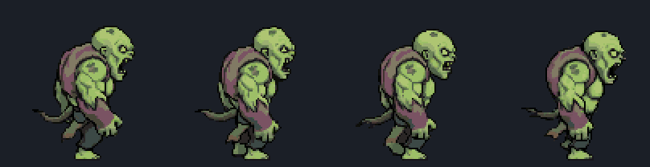

Large 96x96 mini-boss zombie with heavy hurt, part break, blast-back and defeat strips.

- group `brute` · 15 assets · frame 96x96 · key prefix `zombie-brute-` · manifest [enemies/zombies/brute/manifest.json](enemies/zombies/brute/manifest.json)
- previews: [all-actions-sheet.png](previews/zombies/brute/all-actions-sheet.png), [unique-actions-sheet.png](previews/zombies/brute/unique-actions-sheet.png), [special-sheet.png](previews/zombies/brute/special-sheet.png), [elemental-hits-sheet.png](previews/zombies/brute/elemental-hits-sheet.png), [special-sequence.gif](previews/zombies/brute/special-sequence.gif)

| Key | Frames | Size | FPS | Playback | Origin | Notes |
|---|---:|---|---:|---|---|---|
| `zombie-brute-walk` | 8 | 96x96 | 8 | loop | (0.5, 1.0) |  |
| `zombie-brute-run` | 8 | 96x96 | 12 | loop | (0.5, 1.0) |  |
| `zombie-brute-die1` | 8 | 96x96 | 10 | once | (0.5, 1.0) |  |
| `zombie-brute-die2` | 8 | 96x96 | 10 | once | (0.5, 1.0) |  |
| `zombie-brute-attack` | 8 | 96x96 | 10 | loop | (0.5, 1.0) |  |
| `zombie-brute-bite` | 8 | 96x96 | 10 | loop | (0.5, 1.0) |  |
| `zombie-brute-hurt` | 4 | 96x96 | 10 | once | (0.5, 1.0) |  |
| `zombie-brute-idle_itch` | 8 | 96x96 | 6 | loop | (0.5, 1.0) |  |
| `zombie-brute-hurt_freeze` | 8 | 96x96 | 10 | once | (0.5, 1.0) |  |
| `zombie-brute-hurt_burn` | 8 | 96x96 | 10 | loop | (0.5, 1.0) |  |
| `zombie-brute-hurt_shock` | 6 | 96x96 | 12 | loop | (0.5, 1.0) |  |
| `zombie-brute-hurt_heavy` | 6 | 96x96 | 10 | once | (0.5, 1.0) |  |
| `zombie-brute-part_break` | 8 | 96x96 | 10 | once | (0.5, 1.0) |  |
| `zombie-brute-blasted_back` | 8 | 96x96 | 10 | once | (0.5, 1.0) |  |
| `zombie-brute-defeated` | 8 | 96x96 | 10 | once | (0.5, 1.0) |  |

### Comedic Loot Dropper (Clown) (小丑/奇特搞怪喪屍)

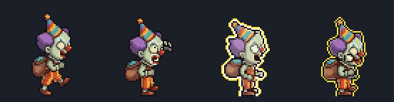

Loot zombie: hurt_loot drops coins/gems, loot_explode bursts on death and ends on the loot-pile pickup (see pickups/clown-loot).

- group `clown` · 13 assets · frame 64x64 · key prefix `zombie-clown-` · manifest [enemies/zombies/clown/manifest.json](enemies/zombies/clown/manifest.json)
- previews: [all-actions-sheet.png](previews/zombies/clown/all-actions-sheet.png), [special-sheet.png](previews/zombies/clown/special-sheet.png), [elemental-hits-sheet.png](previews/zombies/clown/elemental-hits-sheet.png)

| Key | Frames | Size | FPS | Playback | Origin | Notes |
|---|---:|---|---:|---|---|---|
| `zombie-clown-walk` | 8 | 64x64 | 8 | loop | (0.5, 1.0) |  |
| `zombie-clown-run` | 8 | 64x64 | 12 | loop | (0.5, 1.0) |  |
| `zombie-clown-die1` | 8 | 64x64 | 10 | once | (0.5, 1.0) |  |
| `zombie-clown-die2` | 8 | 64x64 | 10 | once | (0.5, 1.0) |  |
| `zombie-clown-attack` | 8 | 64x64 | 10 | loop | (0.5, 1.0) |  |
| `zombie-clown-bite` | 8 | 64x64 | 10 | loop | (0.5, 1.0) |  |
| `zombie-clown-hurt` | 4 | 64x64 | 10 | once | (0.5, 1.0) | Recoils west (snap back), then recovers. |
| `zombie-clown-idle_itch` | 8 | 64x64 | 6 | loop | (0.5, 1.0) |  |
| `zombie-clown-hurt_freeze` | 8 | 64x64 | 10 | once | (0.5, 1.0) |  |
| `zombie-clown-hurt_burn` | 8 | 64x64 | 10 | loop | (0.5, 1.0) |  |
| `zombie-clown-hurt_shock` | 6 | 64x64 | 12 | loop | (0.5, 1.0) |  |
| `zombie-clown-hurt_loot` | 6 | 64x64 | 10 | once | (0.5, 1.0) | Play once on a hit. Coins, gems and confetti popping out of the sack are baked in as visuals; spawn real pickups (zombie-clown-coin / zombie-clown-gem-*) in game at the sack around frame 1-2. |
| `zombie-clown-loot_explode` | 12 | 64x64 | 10 | once | (0.5, 1.0) | Play once on death: inflates like a balloon with a trembling rim flash, sack bulging (0-3), burst (4), coins/gems/confetti/stars rain down while the pile grows (5-10), last frame (11) = zombie-clown-loot-pile frame 0 at the bottom of the 64x64 canvas, so you can swap to the pile pickup (origin bottom-centre) seamlessly. The party hat flies off on the burst. |

### Cyborg Scientist Zombie (半機械改造喪屍)

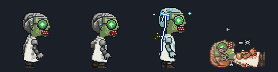

Half-machine zombie: spark hurt, fall, and self-destruct explode strips.

- group `cyborg` · 14 assets · frame 64x64 · key prefix `zombie-cyborg-` · manifest [enemies/zombies/cyborg/manifest.json](enemies/zombies/cyborg/manifest.json)
- previews: [all-actions-sheet.png](previews/zombies/cyborg/all-actions-sheet.png), [special-sheet.png](previews/zombies/cyborg/special-sheet.png), [elemental-hits-sheet.png](previews/zombies/cyborg/elemental-hits-sheet.png), [fall.gif](previews/zombies/cyborg/fall.gif)

| Key | Frames | Size | FPS | Playback | Origin | Notes |
|---|---:|---|---:|---|---|---|
| `zombie-cyborg-walk` | 8 | 64x64 | 8 | loop | (0.5, 1.0) |  |
| `zombie-cyborg-run` | 8 | 64x64 | 12 | loop | (0.5, 1.0) |  |
| `zombie-cyborg-die1` | 8 | 64x64 | 10 | once | (0.5, 1.0) |  |
| `zombie-cyborg-die2` | 8 | 64x64 | 10 | once | (0.5, 1.0) |  |
| `zombie-cyborg-attack` | 8 | 64x64 | 10 | loop | (0.5, 1.0) |  |
| `zombie-cyborg-bite` | 8 | 64x64 | 10 | loop | (0.5, 1.0) |  |
| `zombie-cyborg-hurt` | 4 | 64x64 | 10 | once | (0.5, 1.0) |  |
| `zombie-cyborg-idle_itch` | 8 | 64x64 | 6 | loop | (0.5, 1.0) |  |
| `zombie-cyborg-hurt_freeze` | 8 | 64x64 | 10 | once | (0.5, 1.0) |  |
| `zombie-cyborg-hurt_burn` | 8 | 64x64 | 10 | loop | (0.5, 1.0) |  |
| `zombie-cyborg-hurt_shock` | 6 | 64x64 | 12 | loop | (0.5, 1.0) |  |
| `zombie-cyborg-hurt_spark` | 6 | 64x64 | 12 | loop | (0.5, 1.0) |  |
| `zombie-cyborg-fall` | 8 | 64x64 | 10 | once | (0.5, 1.0) |  |
| `zombie-cyborg-explode` | 8 | 64x64 | 10 | once | (0.5, 1.0) |  |

### Bloated Toxic Exploder (劇毒自爆型喪屍)

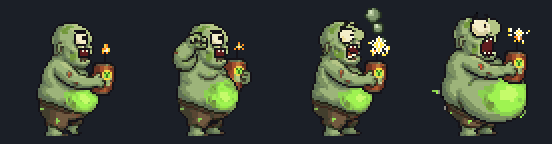

Self-destructing zombie. `zombie-exploder-explode` is the body animation; spawn the shared fx `zombie-exploder-blast` (assets/library/fx) at the body for the chain-reaction blast.

- group `exploder` · 13 assets · frame 64x64 · key prefix `zombie-exploder-` · manifest [enemies/zombies/exploder/manifest.json](enemies/zombies/exploder/manifest.json)
- previews: [all-actions-sheet.png](previews/zombies/exploder/all-actions-sheet.png), [unique-actions-sheet.png](previews/zombies/exploder/unique-actions-sheet.png), [special-sheet.png](previews/zombies/exploder/special-sheet.png), [elemental-hits-sheet.png](previews/zombies/exploder/elemental-hits-sheet.png)

| Key | Frames | Size | FPS | Playback | Origin | Notes |
|---|---:|---|---:|---|---|---|
| `zombie-exploder-walk` | 8 | 64x64 | 8 | loop | (0.5, 1.0) |  |
| `zombie-exploder-run` | 8 | 64x64 | 12 | loop | (0.5, 1.0) |  |
| `zombie-exploder-die1` | 8 | 64x64 | 10 | once | (0.5, 1.0) |  |
| `zombie-exploder-die2` | 8 | 64x64 | 10 | once | (0.5, 1.0) |  |
| `zombie-exploder-attack` | 8 | 64x64 | 10 | loop | (0.5, 1.0) |  |
| `zombie-exploder-bite` | 8 | 64x64 | 10 | loop | (0.5, 1.0) |  |
| `zombie-exploder-hurt` | 4 | 64x64 | 10 | once | (0.5, 1.0) |  |
| `zombie-exploder-idle_itch` | 8 | 64x64 | 6 | loop | (0.5, 1.0) |  |
| `zombie-exploder-hurt_freeze` | 8 | 64x64 | 10 | once | (0.5, 1.0) |  |
| `zombie-exploder-hurt_burn` | 8 | 64x64 | 10 | loop | (0.5, 1.0) |  |
| `zombie-exploder-hurt_shock` | 8 | 64x64 | 12 | loop | (0.5, 1.0) |  |
| `zombie-exploder-hurt_terrified` | 6 | 64x64 | 10 | loop | (0.5, 1.0) |  |
| `zombie-exploder-explode` | 12 | 64x64 | 10 | once | (0.5, 1.0) |  |

### Office Worker Zombie (上班族丧尸)

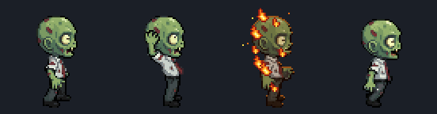

Monster 01. Baseline shambling salaryman zombie: walk/run, attack/bite loops, two deaths, hurt and elemental hit reactions.

- group `office-worker` · 11 assets · frame 64x64 · key prefix `zombie-office-` · manifest [enemies/zombies/office-worker/manifest.json](enemies/zombies/office-worker/manifest.json)
- previews: [all-actions-sheet.png](previews/zombies/office-worker/all-actions-sheet.png), [attack-bite-sheet.png](previews/zombies/office-worker/attack-bite-sheet.png), [elemental-hits-sheet.png](previews/zombies/office-worker/elemental-hits-sheet.png)

| Key | Frames | Size | FPS | Playback | Origin | Notes |
|---|---:|---|---:|---|---|---|
| `zombie-office-walk` | 8 | 64x64 | 8 | loop | (0.5, 1.0) |  |
| `zombie-office-run` | 8 | 64x64 | 12 | loop | (0.5, 1.0) |  |
| `zombie-office-die1` | 8 | 64x64 | 10 | once | (0.5, 1.0) |  |
| `zombie-office-die2` | 8 | 64x64 | 10 | once | (0.5, 1.0) |  |
| `zombie-office-attack` | 8 | 64x64 | 10 | loop | (0.5, 1.0) |  |
| `zombie-office-bite` | 8 | 64x64 | 10 | loop | (0.5, 1.0) |  |
| `zombie-office-hurt` | 4 | 64x64 | 10 | once | (0.5, 1.0) |  |
| `zombie-office-idle_itch` | 8 | 64x64 | 6 | loop | (0.5, 1.0) |  |
| `zombie-office-hurt_freeze` | 8 | 64x64 | 10 | once | (0.5, 1.0) |  |
| `zombie-office-hurt_burn` | 8 | 64x64 | 10 | loop | (0.5, 1.0) |  |
| `zombie-office-hurt_shock` | 6 | 64x64 | 12 | loop | (0.5, 1.0) |  |

### Heavy Armored Riot Zombie (armored) (重裝防爆喪屍（可破甲）)

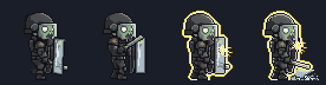

Armored phase with shield: hurt_armor, shield_break (loses shield), armor_break (loses helmet/plates), then switch to the riot-bare group.

- group `riot` · 11 assets · frame 64x64 · key prefix `zombie-riot-` · manifest [enemies/zombies/riot/manifest.json](enemies/zombies/riot/manifest.json)
- previews: [armored-actions-sheet.png](previews/zombies/riot/armored-actions-sheet.png), [special-sheet.png](previews/zombies/riot/special-sheet.png), [elemental-hits-sheet.png](previews/zombies/riot/elemental-hits-sheet.png), [special-sequence.gif](previews/zombies/riot/special-sequence.gif)

| Key | Frames | Size | FPS | Playback | Origin | Notes |
|---|---:|---|---:|---|---|---|
| `zombie-riot-walk` | 8 | 64x64 | 8 | loop | (0.5, 1.0) |  |
| `zombie-riot-run` | 8 | 64x64 | 12 | loop | (0.5, 1.0) |  |
| `zombie-riot-attack` | 8 | 64x64 | 10 | loop | (0.5, 1.0) |  |
| `zombie-riot-bite` | 8 | 64x64 | 10 | loop | (0.5, 1.0) |  |
| `zombie-riot-idle_itch` | 8 | 64x64 | 6 | loop | (0.5, 1.0) |  |
| `zombie-riot-hurt_armor` | 6 | 64x64 | 10 | once | (0.5, 1.0) |  |
| `zombie-riot-shield_break` | 12 | 64x64 | 10 | once | (0.5, 1.0) |  |
| `zombie-riot-armor_break` | 12 | 64x64 | 10 | once | (0.5, 1.0) |  |
| `zombie-riot-hurt_freeze` | 8 | 64x64 | 10 | once | (0.5, 1.0) |  |
| `zombie-riot-hurt_burn` | 8 | 64x64 | 10 | loop | (0.5, 1.0) |  |
| `zombie-riot-hurt_shock` | 6 | 64x64 | 12 | loop | (0.5, 1.0) |  |

### Riot Zombie (bare, after armor break) (防爆喪屍（破甲後）)

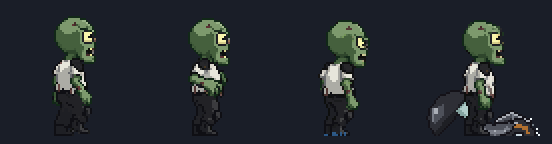

Unarmored phase after `zombie-riot-armor_break`, incl. dismantled_defeat death.

- group `riot-bare` · 12 assets · frame 64x64 · key prefix `zombie-riot-bare-` · manifest [enemies/zombies/riot-bare/manifest.json](enemies/zombies/riot-bare/manifest.json)
- previews: [bare-actions-sheet.png](previews/zombies/riot-bare/bare-actions-sheet.png)

| Key | Frames | Size | FPS | Playback | Origin | Notes |
|---|---:|---|---:|---|---|---|
| `zombie-riot-bare-walk` | 8 | 64x64 | 8 | loop | (0.5, 1.0) |  |
| `zombie-riot-bare-run` | 8 | 64x64 | 12 | loop | (0.5, 1.0) |  |
| `zombie-riot-bare-die1` | 8 | 64x64 | 10 | once | (0.5, 1.0) |  |
| `zombie-riot-bare-die2` | 8 | 64x64 | 10 | once | (0.5, 1.0) |  |
| `zombie-riot-bare-attack` | 8 | 64x64 | 10 | loop | (0.5, 1.0) |  |
| `zombie-riot-bare-bite` | 8 | 64x64 | 10 | loop | (0.5, 1.0) |  |
| `zombie-riot-bare-hurt` | 4 | 64x64 | 10 | once | (0.5, 1.0) |  |
| `zombie-riot-bare-idle_itch` | 8 | 64x64 | 6 | loop | (0.5, 1.0) |  |
| `zombie-riot-bare-hurt_freeze` | 8 | 64x64 | 10 | once | (0.5, 1.0) |  |
| `zombie-riot-bare-hurt_burn` | 8 | 64x64 | 10 | loop | (0.5, 1.0) |  |
| `zombie-riot-bare-hurt_shock` | 6 | 64x64 | 12 | loop | (0.5, 1.0) |  |
| `zombie-riot-bare-dismantled_defeat` | 8 | 64x64 | 10 | once | (0.5, 1.0) |  |

### Splitting Slime Zombie (分裂型史萊姆喪屍)

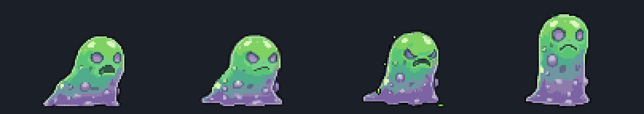

Splits on death: `zombie-slime-split` (96x64) ends as two mini slimes; spawn two slime-mini at spawnOffsetsX.

- group `slime` · 14 assets · frame 64x64, 96x64 · key prefix `zombie-slime-` · manifest [enemies/zombies/slime/manifest.json](enemies/zombies/slime/manifest.json)
- previews: [all-actions-sheet.png](previews/zombies/slime/all-actions-sheet.png), [special-sheet.png](previews/zombies/slime/special-sheet.png), [elemental-hits-sheet.png](previews/zombies/slime/elemental-hits-sheet.png)

| Key | Frames | Size | FPS | Playback | Origin | Notes |
|---|---:|---|---:|---|---|---|
| `zombie-slime-walk` | 8 | 64x64 | 8 | loop | (0.5, 1.0) |  |
| `zombie-slime-run` | 8 | 64x64 | 12 | loop | (0.5, 1.0) |  |
| `zombie-slime-die1` | 8 | 64x64 | 10 | once | (0.5, 1.0) |  |
| `zombie-slime-die2` | 8 | 64x64 | 10 | once | (0.5, 1.0) |  |
| `zombie-slime-attack` | 8 | 64x64 | 10 | loop | (0.5, 1.0) |  |
| `zombie-slime-bite` | 8 | 64x64 | 10 | loop | (0.5, 1.0) |  |
| `zombie-slime-hurt` | 4 | 64x64 | 10 | once | (0.5, 1.0) |  |
| `zombie-slime-idle_itch` | 8 | 64x64 | 6 | loop | (0.5, 1.0) |  |
| `zombie-slime-hurt_freeze` | 8 | 64x64 | 10 | once | (0.5, 1.0) |  |
| `zombie-slime-hurt_burn` | 8 | 64x64 | 10 | loop | (0.5, 1.0) |  |
| `zombie-slime-hurt_shock` | 6 | 64x64 | 12 | loop | (0.5, 1.0) |  |
| `zombie-slime-hurt_jiggle` | 6 | 64x64 | 10 | loop | (0.5, 1.0) |  |
| `zombie-slime-split` | 8 | 96x64 | 10 | once | (0.5, 1.0) | spawnOffsetsX [-28, 28] · 96x64 canvas (wider than the 64x64 base). Same origin semantics (0.5,1.0): canvas centre-bottom = slime position. Ends as two slime-mini stand poses; swap to zombie-slime-mini-* at x offsets spawnOffsetsX. |
| `zombie-slime-splatter` | 8 | 64x64 | 10 | once | (0.5, 1.0) |  |

### Mini Slime (split child) (小史萊姆)

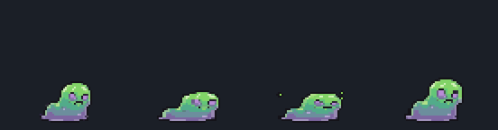

Child slime spawned by zombie-slime-split. 64x64 canvas, smaller body.

- group `slime-mini` · 6 assets · frame 64x64 · key prefix `zombie-slime-mini-` · manifest [enemies/zombies/slime-mini/manifest.json](enemies/zombies/slime-mini/manifest.json)
- previews: [mini-actions-sheet.png](previews/zombies/slime-mini/mini-actions-sheet.png)

| Key | Frames | Size | FPS | Playback | Origin | Notes |
|---|---:|---|---:|---|---|---|
| `zombie-slime-mini-walk` | 8 | 64x64 | 8 | loop | (0.5, 1.0) |  |
| `zombie-slime-mini-idle` | 8 | 64x64 | 6 | loop | (0.5, 1.0) |  |
| `zombie-slime-mini-run` | 8 | 64x64 | 12 | loop | (0.5, 1.0) |  |
| `zombie-slime-mini-hurt` | 4 | 64x64 | 10 | once | (0.5, 1.0) |  |
| `zombie-slime-mini-die` | 8 | 64x64 | 10 | once | (0.5, 1.0) |  |
| `zombie-slime-mini-splatter` | 8 | 64x64 | 10 | once | (0.5, 1.0) |  |

### Fast Runner (high knockback) (瘋狂奔跑與擊飛喪屍)

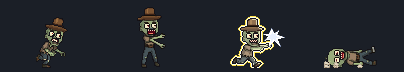

Fast zombie that gets launched: blasted_back + tumble (96x64, translate x in code) then comedic_ko (loops frames 4-7).

- group `sprinter` · 14 assets · frame 64x64, 96x64 · key prefix `zombie-sprinter-` · manifest [enemies/zombies/sprinter/manifest.json](enemies/zombies/sprinter/manifest.json)
- previews: [all-actions-sheet.png](previews/zombies/sprinter/all-actions-sheet.png), [special-sheet.png](previews/zombies/sprinter/special-sheet.png), [elemental-hits-sheet.png](previews/zombies/sprinter/elemental-hits-sheet.png)

| Key | Frames | Size | FPS | Playback | Origin | Notes |
|---|---:|---|---:|---|---|---|
| `zombie-sprinter-walk` | 8 | 64x64 | 8 | loop | (0.5, 1.0) |  |
| `zombie-sprinter-run` | 8 | 64x64 | 12 | loop | (0.5, 1.0) |  |
| `zombie-sprinter-die1` | 8 | 64x64 | 10 | once | (0.5, 1.0) |  |
| `zombie-sprinter-die2` | 8 | 64x64 | 10 | once | (0.5, 1.0) |  |
| `zombie-sprinter-attack` | 8 | 64x64 | 10 | loop | (0.5, 1.0) |  |
| `zombie-sprinter-bite` | 8 | 64x64 | 10 | loop | (0.5, 1.0) |  |
| `zombie-sprinter-hurt` | 4 | 64x64 | 10 | once | (0.5, 1.0) |  |
| `zombie-sprinter-idle_itch` | 8 | 64x64 | 6 | loop | (0.5, 1.0) |  |
| `zombie-sprinter-hurt_freeze` | 8 | 64x64 | 10 | once | (0.5, 1.0) |  |
| `zombie-sprinter-hurt_burn` | 8 | 64x64 | 10 | loop | (0.5, 1.0) |  |
| `zombie-sprinter-hurt_shock` | 6 | 64x64 | 12 | loop | (0.5, 1.0) |  |
| `zombie-sprinter-blasted_back` | 8 | 96x64 | 10 | once | (0.5, 1.0) | 96x64 canvas, same origin semantics (0.5,1.0) = ground point under the zombie. Body stays in place horizontally: the game applies the westward knockback translation (e.g. tween x by -40..-80px over blasted_back+tumble). Vertical airborne arc, white shockwave burst, speed streaks and the hat + one shoe flying off are baked in. After this the zombie is hatless with one sock (tumble/comedic_ko). |
| `zombie-sprinter-tumble` | 10 | 96x64 | 10 | once | (0.5, 1.0) | 96x64 canvas, same origin semantics; in place horizontally (keep applying knockback translation); bounce, backward roll and dust baked in. |
| `zombie-sprinter-comedic_ko` | 8 | 64x64 | 10 | start 0-3 once, loop 4-7 | (0.5, 1.0) | Play once, then loop frames 4-7 (dizzy stars orbit + twitching foot). Ends lying on its back. |

### Trash Can Armor Zombie (armored) (垃圾桶防禦喪屍)

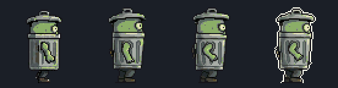

Armored phase: zombie wearing a trash can. Absorbs hits (hurt_armor); `zombie-trashcan-break` knocks the can off, then switch to the trashcan-bare group. No death strips in this phase (die as trashcan-bare).

- group `trashcan` · 10 assets · frame 64x64 · key prefix `zombie-trashcan-` · manifest [enemies/zombies/trashcan/manifest.json](enemies/zombies/trashcan/manifest.json)
- previews: [armored-actions-sheet.png](previews/zombies/trashcan/armored-actions-sheet.png), [special-sheet.png](previews/zombies/trashcan/special-sheet.png), [elemental-hits-sheet.png](previews/zombies/trashcan/elemental-hits-sheet.png)

| Key | Frames | Size | FPS | Playback | Origin | Notes |
|---|---:|---|---:|---|---|---|
| `zombie-trashcan-walk` | 8 | 64x64 | 8 | loop | (0.5, 1.0) |  |
| `zombie-trashcan-run` | 8 | 64x64 | 12 | loop | (0.5, 1.0) |  |
| `zombie-trashcan-attack` | 8 | 64x64 | 10 | loop | (0.5, 1.0) |  |
| `zombie-trashcan-bite` | 8 | 64x64 | 10 | loop | (0.5, 1.0) |  |
| `zombie-trashcan-idle_itch` | 8 | 64x64 | 6 | loop | (0.5, 1.0) |  |
| `zombie-trashcan-hurt_armor` | 6 | 64x64 | 10 | once | (0.5, 1.0) |  |
| `zombie-trashcan-break` | 8 | 64x64 | 10 | once | (0.5, 1.0) |  |
| `zombie-trashcan-hurt_freeze` | 8 | 64x64 | 10 | once | (0.5, 1.0) |  |
| `zombie-trashcan-hurt_burn` | 8 | 64x64 | 10 | loop | (0.5, 1.0) |  |
| `zombie-trashcan-hurt_shock` | 6 | 64x64 | 12 | loop | (0.5, 1.0) |  |

### Trash Can Zombie (bare, after break) (垃圾桶喪屍（破甲後）)

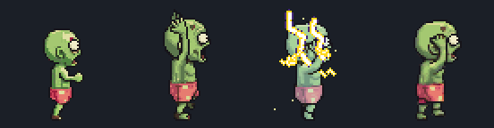

Unarmored phase after `zombie-trashcan-break`: full move set plus a panic run.

- group `trashcan-bare` · 12 assets · frame 64x64 · key prefix `zombie-trashcan-bare-` · manifest [enemies/zombies/trashcan-bare/manifest.json](enemies/zombies/trashcan-bare/manifest.json)
- previews: [bare-actions-sheet.png](previews/zombies/trashcan-bare/bare-actions-sheet.png)

| Key | Frames | Size | FPS | Playback | Origin | Notes |
|---|---:|---|---:|---|---|---|
| `zombie-trashcan-bare-walk` | 8 | 64x64 | 8 | loop | (0.5, 1.0) |  |
| `zombie-trashcan-bare-run` | 8 | 64x64 | 12 | loop | (0.5, 1.0) |  |
| `zombie-trashcan-bare-die1` | 8 | 64x64 | 10 | once | (0.5, 1.0) |  |
| `zombie-trashcan-bare-die2` | 8 | 64x64 | 10 | once | (0.5, 1.0) |  |
| `zombie-trashcan-bare-attack` | 8 | 64x64 | 10 | loop | (0.5, 1.0) |  |
| `zombie-trashcan-bare-bite` | 8 | 64x64 | 10 | loop | (0.5, 1.0) |  |
| `zombie-trashcan-bare-hurt` | 4 | 64x64 | 10 | once | (0.5, 1.0) |  |
| `zombie-trashcan-bare-idle_itch` | 8 | 64x64 | 6 | loop | (0.5, 1.0) |  |
| `zombie-trashcan-bare-hurt_freeze` | 8 | 64x64 | 10 | once | (0.5, 1.0) |  |
| `zombie-trashcan-bare-hurt_burn` | 8 | 64x64 | 10 | loop | (0.5, 1.0) |  |
| `zombie-trashcan-bare-hurt_shock` | 6 | 64x64 | 12 | loop | (0.5, 1.0) |  |
| `zombie-trashcan-bare-panic` | 8 | 64x64 | 10 | loop | (0.5, 1.0) |  |

## Bosses

### The Molten Giant, Balon (熔岩巨魔・巴倫)

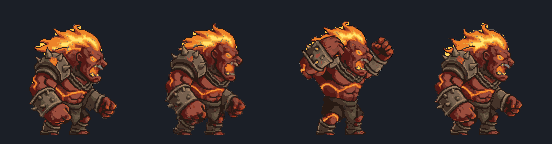

Lava boss (128x128). Skills: lava_slam (fx-slam at impact), volcanic_breath (sustained start/loop/end + fx-breath attached at the mouth), meteor_storm (spawn fx-meteor + fx-meteor-impact during castFrames).

- group `lava-balon` · 15 assets · frame 128x128 · key prefix `zombie-boss-lava-` · manifest [enemies/bosses/lava-balon/manifest.json](enemies/bosses/lava-balon/manifest.json)
- previews: [all-actions-sheet.png](previews/bosses/lava-balon/all-actions-sheet.png), [skills-sheet.png](previews/bosses/lava-balon/skills-sheet.png), [elemental-hits-sheet.png](previews/bosses/lava-balon/elemental-hits-sheet.png), [skill-lava_slam.gif](previews/bosses/lava-balon/skill-lava_slam.gif), [skill-volcanic_breath.gif](previews/bosses/lava-balon/skill-volcanic_breath.gif), [skill-meteor_storm.gif](previews/bosses/lava-balon/skill-meteor_storm.gif)

| Key | Frames | Size | FPS | Playback | Origin | Notes |
|---|---:|---|---:|---|---|---|
| `zombie-boss-lava-spawn` | 12 | 128x128 | 10 | once | (0.5, 1.0) | rises out of a lava pool (frames 0-5), then roars (6-11) |
| `zombie-boss-lava-idle` | 8 | 128x128 | 6 | loop | (0.5, 1.0) |  |
| `zombie-boss-lava-walk` | 8 | 128x128 | 8 | loop | (0.5, 1.0) |  |
| `zombie-boss-lava-run` | 8 | 128x128 | 12 | loop | (0.5, 1.0) |  |
| `zombie-boss-lava-attack` | 8 | 128x128 | 10 | loop | (0.5, 1.0) |  |
| `zombie-boss-lava-hurt` | 6 | 128x128 | 10 | once | (0.5, 1.0) |  |
| `zombie-boss-lava-hurt_freeze` | 8 | 128x128 | 10 | once | (0.5, 1.0) | lava cools to a dark slate crust, ice crystals + ice mound; ends frozen (hold last frame) |
| `zombie-boss-lava-hurt_burn` | 8 | 128x128 | 10 | loop | (0.5, 1.0) | overheat / flare variant: lava cracks blaze white-hot, flame mane flares |
| `zombie-boss-lava-hurt_shock` | 6 | 128x128 | 12 | loop | (0.5, 1.0) |  |
| `zombie-boss-lava-enrage` | 8 | 128x128 | 8 | loop | (0.5, 1.0) |  |
| `zombie-boss-lava-die1` | 12 | 128x128 | 10 | once | (0.5, 1.0) |  |
| `zombie-boss-lava-die2` | 12 | 128x128 | 10 | once | (0.5, 1.0) |  |
| `zombie-boss-lava-lava_slam` | 12 | 128x128 | 10 | once | (0.5, 1.0) | fx: `zombie-boss-lava-fx-slam` · 0-4 wind-up, 5-6 down-swing (smear), 7 impact (start fx-slam), 8-11 recovery |
| `zombie-boss-lava-volcanic_breath` | 12 | 128x128 | 10 | start 0-4 once, loop 5-10, end 11-11 once | (0.5, 1.0) | fx: `zombie-boss-lava-fx-breath` · play startRange once, repeat loopRange while breathing, then endRange; fx-breath is attached from character frame 4 |
| `zombie-boss-lava-meteor_storm` | 12 | 128x128 | 10 | once | (0.5, 1.0) | fx: `zombie-boss-lava-fx-meteor`, `zombie-boss-lava-fx-meteor-impact` |

### The Molten Giant, Balon — skill FX (熔岩巨魔・巴倫 技能特效)

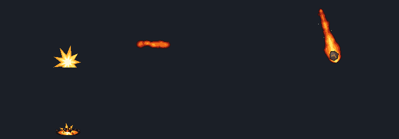

Skill FX strips for The Molten Giant, Balon. Origins and attach offsets are per key (see anchors/timing); offsets are in px relative to the boss origin (bottom-centre), east-facing; mirror x if the boss is flipped.

- group `lava-balon-fx` · 4 assets · frame 64x128, 96x64, 256x96, 256x128 · key prefix `zombie-boss-lava-fx-` · manifest [enemies/bosses/lava-balon/fx/manifest.json](enemies/bosses/lava-balon/fx/manifest.json)
- previews: [fx-slam-sheet.png](previews/bosses/lava-balon-fx/fx-slam-sheet.png), [fx-breath-sheet.png](previews/bosses/lava-balon-fx/fx-breath-sheet.png), [fx-meteor-sheet.png](previews/bosses/lava-balon-fx/fx-meteor-sheet.png), [fx-meteor-impact-sheet.png](previews/bosses/lava-balon-fx/fx-meteor-impact-sheet.png)

| Key | Frames | Size | FPS | Playback | Origin | Notes |
|---|---:|---|---:|---|---|---|
| `zombie-boss-lava-fx-slam` | 12 | 256x128 | 12 | once | (0.5, 1.0) | attach to `zombie-boss-lava-lava_slam` frame 7 offset [44, 0] · ground crack + shockwave expand east, lava geysers erupt from the cracks, rock debris, dust; good moment for screen shake: fx frames 0-3 |
| `zombie-boss-lava-fx-breath` | 14 | 256x96 | 12 | start 0-3 once, loop 4-9, end 10-13 once | (0.0, 0.5) | attach to `zombie-boss-lava-volcanic_breath` frame 4 offset [56, -80] · play 0-3 once, loop 4-9 while the character loops its frames 5-10, then 10-13 once (stream detaches and burns out) |
| `zombie-boss-lava-fx-meteor` | 6 | 64x128 | 12 | loop | (0.59375, 0.8125) | single meteor; the game moves it along travelDirection (down, slightly east) and spawns fx-meteor-impact where the rock meets the ground. spawn many during meteor_storm castFrames |
| `zombie-boss-lava-fx-meteor-impact` | 8 | 96x64 | 12 | once | (0.5, 1.0) |  |

### The Cyber-Steel Behemoth, Balam (鋼鐵巨獸・巴拉姆)

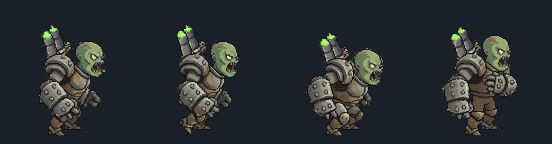

Steel boss (128x128). Skills: ground_smash (fx-smash at impactPoint), bio_acid_spit (sustained loop 7-10 + fx-acid on mouthAnchors, fx-acid-pool on the ground), steel_whirlwind (loop 3-8 with fx-whirlwind front + back layers).

- group `steel-balam` · 15 assets · frame 128x128 · key prefix `zombie-boss-steel-` · manifest [enemies/bosses/steel-balam/manifest.json](enemies/bosses/steel-balam/manifest.json)
- previews: [all-actions-sheet.png](previews/bosses/steel-balam/all-actions-sheet.png), [skills-sheet.png](previews/bosses/steel-balam/skills-sheet.png), [elemental-hits-sheet.png](previews/bosses/steel-balam/elemental-hits-sheet.png), [skill-ground_smash.gif](previews/bosses/steel-balam/skill-ground_smash.gif), [skill-bio_acid_spit.gif](previews/bosses/steel-balam/skill-bio_acid_spit.gif), [skill-steel_whirlwind.gif](previews/bosses/steel-balam/skill-steel_whirlwind.gif)

| Key | Frames | Size | FPS | Playback | Origin | Notes |
|---|---:|---|---:|---|---|---|
| `zombie-boss-steel-spawn` | 12 | 128x128 | 10 | once | (0.5, 1.0) |  |
| `zombie-boss-steel-idle` | 8 | 128x128 | 6 | loop | (0.5, 1.0) |  |
| `zombie-boss-steel-walk` | 8 | 128x128 | 8 | loop | (0.5, 1.0) |  |
| `zombie-boss-steel-run` | 8 | 128x128 | 12 | loop | (0.5, 1.0) |  |
| `zombie-boss-steel-attack` | 8 | 128x128 | 10 | once | (0.5, 1.0) |  |
| `zombie-boss-steel-hurt` | 8 | 128x128 | 12 | once | (0.5, 1.0) |  |
| `zombie-boss-steel-hurt_freeze` | 8 | 128x128 | 10 | once | (0.5, 1.0) |  |
| `zombie-boss-steel-hurt_burn` | 8 | 128x128 | 10 | loop | (0.5, 1.0) |  |
| `zombie-boss-steel-hurt_shock` | 6 | 128x128 | 12 | loop | (0.5, 1.0) |  |
| `zombie-boss-steel-enrage` | 8 | 128x128 | 10 | loop | (0.5, 1.0) | low-HP rage loop |
| `zombie-boss-steel-ground_smash` | 12 | 128x128 | 10 | once | (0.5, 1.0) | fx: `zombie-boss-steel-fx-smash` · impactPoint [49, 0] |
| `zombie-boss-steel-bio_acid_spit` | 12 | 128x128 | 10 | start 0-6 once, loop 7-10, end 11-11 once | (0.5, 1.0) | fx: `zombie-boss-steel-fx-acid`, `zombie-boss-steel-fx-acid-pool` · mouthAnchors per frame |
| `zombie-boss-steel-steel_whirlwind` | 12 | 128x128 | 12 | start 0-2 once, loop 3-8, end 9-11 once | (0.5, 1.0) | fx: `zombie-boss-steel-fx-whirlwind`, `zombie-boss-steel-fx-whirlwind-back` |
| `zombie-boss-steel-die1` | 12 | 128x128 | 10 | once | (0.5, 1.0) |  |
| `zombie-boss-steel-die2` | 12 | 128x128 | 10 | once | (0.5, 1.0) | big defeat, clearly different from die1 (kneel then face-down collapse, plates pop off, toxic smoke) |

### The Cyber-Steel Behemoth, Balam — skill FX (鋼鐵巨獸・巴拉姆 技能特效)

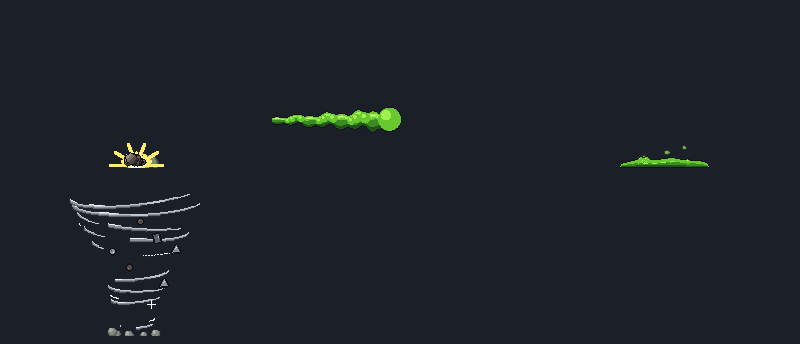

Skill FX strips for The Cyber-Steel Behemoth, Balam. Origins and attach offsets are per key (see anchors/timing); offsets are in px relative to the boss origin (bottom-centre), east-facing; mirror x if the boss is flipped.

- group `steel-balam-fx` · 5 assets · frame 96x32, 160x160, 256x96, 256x128 · key prefix `zombie-boss-steel-fx-` · manifest [enemies/bosses/steel-balam/fx/manifest.json](enemies/bosses/steel-balam/fx/manifest.json)

| Key | Frames | Size | FPS | Playback | Origin | Notes |
|---|---:|---|---:|---|---|---|
| `zombie-boss-steel-fx-smash` | 10 | 256x128 | 12 | once | (0.5, 1.0) | plays from ground_smash character frame 5; origin (bottom-center) goes on the fist impact point = character origin + (49,0) px |
| `zombie-boss-steel-fx-acid` | 10 | 256x96 | 10 | start 0-1 once, loop 2-5, end 6-9 once | (0.0, 0.5) | origin (left-middle) goes on the mouth anchor of the current bio_acid_spit frame (mouthAnchors). Start frames play with character frames 4-5, loop while the character loops 6-9, end frames play after (stream detaches). |
| `zombie-boss-steel-fx-acid-pool` | 8 | 96x32 | 8 | loop | (0.5, 1.0) | lingering damage puddle, origin bottom-center on the ground |
| `zombie-boss-steel-fx-whirlwind` | 8 | 160x160 | 14 | loop | (0.5, 1.0) | front layer: draw OVER the boss; origin bottom-center = boss origin; play while steel_whirlwind loops (frames 2-7) |
| `zombie-boss-steel-fx-whirlwind-back` | 8 | 160x160 | 14 | loop | (0.5, 1.0) | back layer: draw UNDER the boss, same origin/timing as fx-whirlwind |

## Shared FX

### Exploder Toxic Blast (劇毒爆炸)

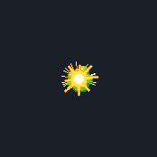

Standalone 160x160 toxic explosion, origin centre (0.5,0.5). Spawn where zombie-exploder dies / explodes; reusable for any chain-reaction or bomb.

- group `exploder-blast` · 1 assets · frame 160x160 · manifest [fx/manifest.json](fx/manifest.json)
- previews: [blast-sheet.png](previews/fx/exploder-blast/blast-sheet.png)

| Key | Frames | Size | FPS | Playback | Origin | Notes |
|---|---:|---|---:|---|---|---|
| `zombie-exploder-blast` | 10 | 160x160 | 12 | once | (0.5, 0.5) |  |

## Pickups

### Clown Loot Pickups (小丑掉落物)

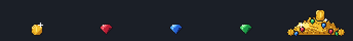

16x16 spinning coin and three gems (origin centre) plus a 64x32 loot pile (origin bottom-centre, = last frame of zombie-clown-loot_explode).

- group `clown-loot` · 5 assets · frame 16x16, 64x32 · key prefix `zombie-clown-` · manifest [pickups/manifest.json](pickups/manifest.json)
- previews: [pickups-sheet.png](previews/pickups/clown-loot/pickups-sheet.png)

| Key | Frames | Size | FPS | Playback | Origin | Notes |
|---|---:|---|---:|---|---|---|
| `zombie-clown-coin` | 8 | 16x16 | 10 | loop | (0.5, 0.5) | 16x16 spinning gold coin pickup, loop. |
| `zombie-clown-gem-red` | 6 | 16x16 | 8 | loop | (0.5, 0.5) | 16x16 sparkling red gem pickup, loop. |
| `zombie-clown-gem-blue` | 6 | 16x16 | 8 | loop | (0.5, 0.5) | 16x16 sparkling blue gem pickup, loop. |
| `zombie-clown-gem-green` | 6 | 16x16 | 8 | loop | (0.5, 0.5) | 16x16 sparkling green gem pickup, loop. |
| `zombie-clown-loot-pile` | 4 | 64x32 | 6 | loop | (0.5, 1.0) | 64x32 coin/gem pile (static = frame 0, or loop the 4-frame sparkle). Same art as the last frame of loot_explode. |

## Environment

### Barricade Fence Posts (圍欄木樁)

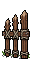

Tileable wooden picket barricade posts with clear gaps between stakes (bullets read as pass-through; monsters blocked by collision code). Brown weathered wood ~#6b4f35. Origin feet (0.5, 1.0). Visual only — Barricade.js contact face stays code-driven.

- group `barricade` · 2 assets · frame 32x64 · key prefix `barricade-` · manifest [environment/barricade/manifest.json](environment/barricade/manifest.json)
- previews: [barricade-sheet.png](previews/environment/barricade/barricade-sheet.png)

| Key | File | Size | Type | Notes |
|---|---|---|---|---|
| `barricade-post` | [barricade-post.png](environment/barricade/barricade-post.png) | 32x64 | icon | Replace rectangle posts (0x6b4f35) via PIXELLAB_HOOK. Collision unchanged (left face). |
| `barricade-post-damaged` | [barricade-post-damaged.png](environment/barricade/barricade-post-damaged.png) | 32x64 | icon | Optional HP-threshold swap; same origin and scale as barricade-post. |

## Backgrounds

### Campus Battle Background (校園戰場背景)

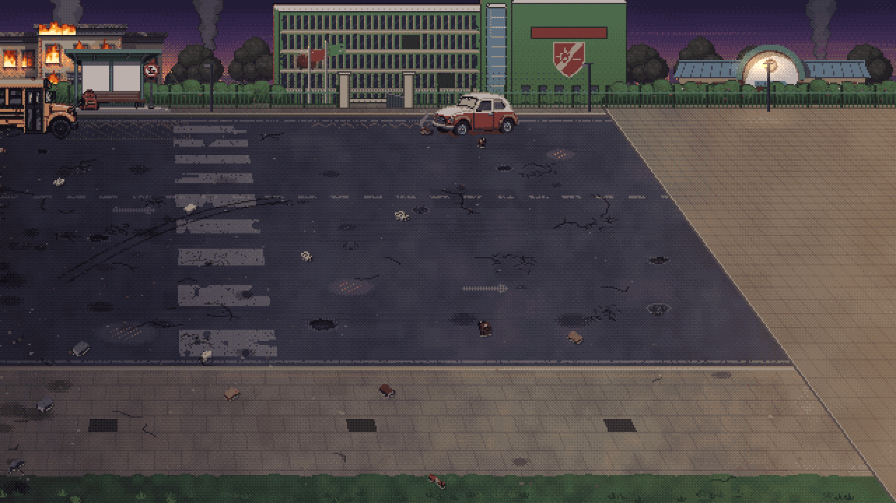

1280x720 campus background (authored 640x360, 2x nearest). Variants A (road, dusk, best), B (yard, dusk), C (night A). Layered far/ground/mid + animated fire and lamp glow. Top-left goes at world (832, 0) = the fixed camera scrollX.

- group `campus` · 15 assets · frame 112x52, 170x126, 1280x720, 1360x768 · key prefix `bg-campus-` · manifest [backgrounds/campus/manifest.json](backgrounds/campus/manifest.json)
- previews: [variants-sheet.png](previews/backgrounds/campus/variants-sheet.png), [mock-A.png](previews/backgrounds/campus/mock-A.png), [mock-B.png](previews/backgrounds/campus/mock-B.png), [mock-C.png](previews/backgrounds/campus/mock-C.png), [preview-B.gif](previews/backgrounds/campus/preview-B.gif), [preview-C.gif](previews/backgrounds/campus/preview-C.gif)

| Key | File | Size | Type | Notes |
|---|---|---|---|---|
| `bg-campus-a` | [variant-A.png](backgrounds/campus/variant-A.png) | 1280x720 | background | Variant A (best): road in front of the school gate at dusk, flattened 1280x720 (fire frame 0 baked in). |
| `bg-campus-b` | [variant-B.png](backgrounds/campus/variant-B.png) | 1280x720 | background | Variant B: school yard at dusk (pitch, statue, hoop, pond), flattened 1280x720. |
| `bg-campus-c` | [variant-C.png](backgrounds/campus/variant-C.png) | 1280x720 | background | Variant C: night version of A, relit, flattened 1280x720. |
| `bg-campus-far` | [bg-far.png](backgrounds/campus/layers/bg-far.png) | 1280x720 | background | Layer: opaque sky, skyline, buildings, trees, smoke — variant A (dusk). Depth 3. |
| `bg-campus-ground` | [bg-ground.png](backgrounds/campus/layers/bg-ground.png) | 1280x720 | background | Layer: perspective ground, transparent above y=148 — variant A (dusk). Depth 4. |
| `bg-campus-mid` | [bg-mid.png](backgrounds/campus/layers/bg-mid.png) | 1280x720 | background | Layer: transparent fence, gate, hedges, flags, lamps, bus stop, car, bus — variant A (dusk). Depth 5. |
| `bg-campus-full` | [bg-full.png](backgrounds/campus/layers/bg-full.png) | 1280x720 | background | Layer stack flattened (identical to variant-A.png) — variant A (dusk). |
| `bg-campus-full-bleed` | [bg-full-bleed.png](backgrounds/campus/layers/bg-full-bleed.png) | 1360x768 | background | 1360x768 flattened with mirrored 40/24px margins for camera shake — variant A (dusk). Place at (832-40, -24). |
| `bg-campus-night-far` | [bg-far.png](backgrounds/campus/layers-night/bg-far.png) | 1280x720 | background | Layer: opaque sky, skyline, buildings, trees, smoke — variant C (night). Depth 3. |
| `bg-campus-night-ground` | [bg-ground.png](backgrounds/campus/layers-night/bg-ground.png) | 1280x720 | background | Layer: perspective ground, transparent above y=148 — variant C (night). Depth 4. |
| `bg-campus-night-mid` | [bg-mid.png](backgrounds/campus/layers-night/bg-mid.png) | 1280x720 | background | Layer: transparent fence, gate, hedges, flags, lamps, bus stop, car, bus — variant C (night). Depth 5. |
| `bg-campus-night-full` | [bg-full.png](backgrounds/campus/layers-night/bg-full.png) | 1280x720 | background | Layer stack flattened (identical to variant-C.png) — variant C (night). |
| `bg-campus-night-full-bleed` | [bg-full-bleed.png](backgrounds/campus/layers-night/bg-full-bleed.png) | 1360x768 | background | 1360x768 flattened with mirrored 40/24px margins for camera shake — variant C (night). Place at (832-40, -24). |
| `bg-campus-fire` | [fire-burning-block.png](backgrounds/campus/anim/fire-burning-block.png) | 170x126 | spritesheet | 8f @ 10fps loop. Seamless 8-frame fire loop for the burning block (9 windows + roof). Layers contain no baked flames; flattened variants have frame 0 baked in. |
| `bg-campus-lamp` | [lamp-glow.png](backgrounds/campus/anim/lamp-glow.png) | 112x52 | spritesheet | 6f @ 6fps loop. Lamp flicker glow, 6 frames, additive blend (ADD). |

## Concepts

### Chibi Zombie Concept Drafts (Q版喪屍概念草圖)

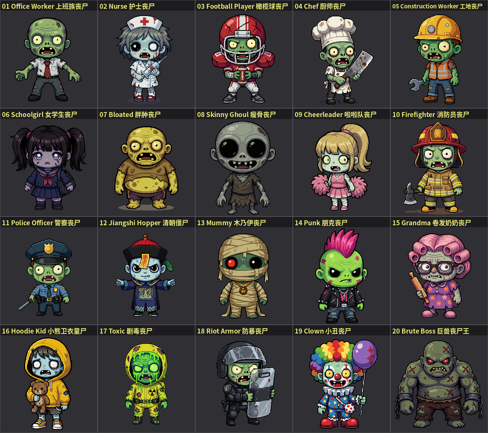

20 front-view 256x256 concept images (PixelLab create_image_pixen). Concept art only — NOT game-ready sprites (no animation, wrong facing). Use as design reference.

- group `zombie-chibi-drafts` · 21 assets · frame 256x256, 1280x1136 · key prefix `concept-chibi-` · manifest [concepts/zombie-chibi-drafts/manifest.json](concepts/zombie-chibi-drafts/manifest.json)
- previews: [contact-sheet.png](previews/concepts/zombie-chibi-drafts/contact-sheet.png)

| Key | File | Size | Type | Notes |
|---|---|---|---|---|
| `concept-chibi-01-office-worker` | [01_office-worker.png](concepts/zombie-chibi-drafts/01_office-worker.png) | 256x256 | concept | Office Worker Zombie / 上班族丧尸 |
| `concept-chibi-02-nurse` | [02_nurse.png](concepts/zombie-chibi-drafts/02_nurse.png) | 256x256 | concept | Nurse Zombie / 护士丧尸 |
| `concept-chibi-03-football-player` | [03_football-player.png](concepts/zombie-chibi-drafts/03_football-player.png) | 256x256 | concept | Football Player Zombie / 橄榄球丧尸 |
| `concept-chibi-04-chef` | [04_chef.png](concepts/zombie-chibi-drafts/04_chef.png) | 256x256 | concept | Chef Zombie / 厨师丧尸 |
| `concept-chibi-05-construction-worker` | [05_construction-worker.png](concepts/zombie-chibi-drafts/05_construction-worker.png) | 256x256 | concept | Construction Worker Zombie / 工地丧尸 |
| `concept-chibi-06-schoolgirl` | [06_schoolgirl.png](concepts/zombie-chibi-drafts/06_schoolgirl.png) | 256x256 | concept | Schoolgirl Zombie / 女学生丧尸 |
| `concept-chibi-07-bloated` | [07_bloated.png](concepts/zombie-chibi-drafts/07_bloated.png) | 256x256 | concept | Bloated Zombie / 胖肿丧尸 |
| `concept-chibi-08-skinny-ghoul` | [08_skinny-ghoul.png](concepts/zombie-chibi-drafts/08_skinny-ghoul.png) | 256x256 | concept | Skinny Ghoul / 瘦骨丧尸 |
| `concept-chibi-09-cheerleader` | [09_cheerleader.png](concepts/zombie-chibi-drafts/09_cheerleader.png) | 256x256 | concept | Cheerleader Zombie / 啦啦队丧尸 |
| `concept-chibi-10-firefighter` | [10_firefighter.png](concepts/zombie-chibi-drafts/10_firefighter.png) | 256x256 | concept | Firefighter Zombie / 消防员丧尸 |
| `concept-chibi-11-police-officer` | [11_police-officer.png](concepts/zombie-chibi-drafts/11_police-officer.png) | 256x256 | concept | Police Officer Zombie / 警察丧尸 |
| `concept-chibi-12-jiangshi` | [12_jiangshi.png](concepts/zombie-chibi-drafts/12_jiangshi.png) | 256x256 | concept | Jiangshi Hopper / 清朝僵尸 |
| `concept-chibi-13-mummy` | [13_mummy.png](concepts/zombie-chibi-drafts/13_mummy.png) | 256x256 | concept | Mummy Zombie / 木乃伊丧尸 |
| `concept-chibi-14-punk` | [14_punk.png](concepts/zombie-chibi-drafts/14_punk.png) | 256x256 | concept | Punk Zombie / 朋克丧尸 |
| `concept-chibi-15-grandma` | [15_grandma.png](concepts/zombie-chibi-drafts/15_grandma.png) | 256x256 | concept | Grandma Zombie / 卷发奶奶丧尸 |
| `concept-chibi-16-kid-teddy` | [16_kid-teddy.png](concepts/zombie-chibi-drafts/16_kid-teddy.png) | 256x256 | concept | Hoodie Kid Zombie / 小熊卫衣童尸 |
| `concept-chibi-17-toxic` | [17_toxic.png](concepts/zombie-chibi-drafts/17_toxic.png) | 256x256 | concept | Toxic Zombie / 剧毒丧尸 |
| `concept-chibi-18-riot-armor` | [18_riot-armor.png](concepts/zombie-chibi-drafts/18_riot-armor.png) | 256x256 | concept | Riot Armor Zombie / 防暴丧尸 |
| `concept-chibi-19-clown` | [19_clown.png](concepts/zombie-chibi-drafts/19_clown.png) | 256x256 | concept | Clown Zombie / 小丑丧尸 |
| `concept-chibi-20-brute-boss` | [20_brute-boss.png](concepts/zombie-chibi-drafts/20_brute-boss.png) | 256x256 | concept | Brute Boss Zombie / 巨兽丧尸王 |
| `concept-chibi-contact-sheet` | [contact-sheet.png](concepts/zombie-chibi-drafts/contact-sheet.png) | 1280x1136 | concept | Contact sheet of all 20 chibi zombie concepts (5x4). |
